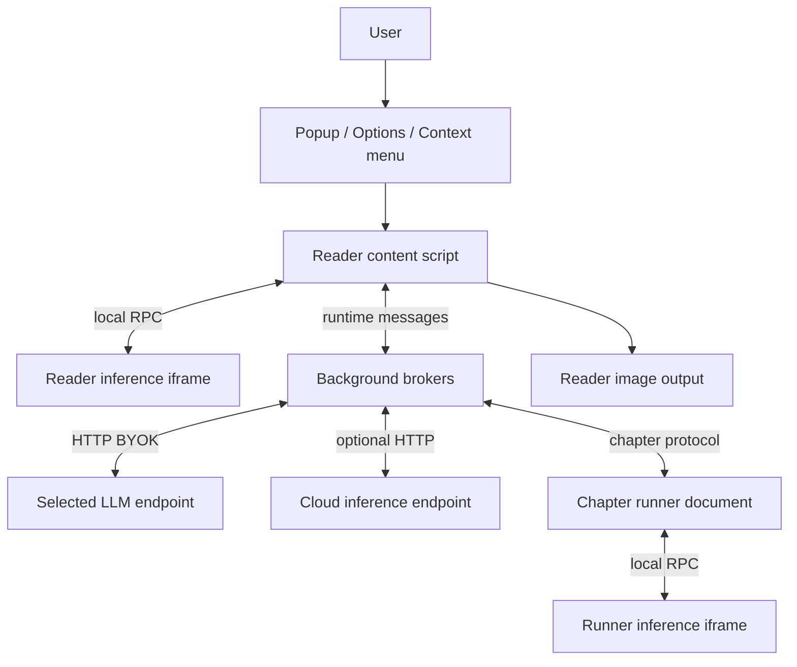

# Architecture

English | [ภาษาไทย](th/architecture.md)

[Index](README.md) · [Next: Translation pipeline](translation-pipeline.md)

## 1. Overview

Arn Manga is a Manifest V3 extension that reads comic images, detects lettering,
sends the required inputs to the user's selected LLM and draws translations back
onto the images. The local pipeline needs no developer-operated backend.
Translation uses a BYOK endpoint; models may need an initial download.

Two choices are independent:

- **Where inference runs**: `local` performs detection/OCR/AI cleanup on-device;
  `cloud` sends that work to the configured endpoint.
- **What the LLM reads**: `page` sends annotated pages plus crops, `crops` sends
  only crops, and `ocr` sends recognized text. A separate VLM may transcribe before translation.

## 2. Component overview

The reader and runner inference documents use the same source but run separately.
Model files share extension-origin IndexedDB, but sessions, queues and
inference allocations belong to each document. There is no browser-wide GPU mutex.

The queue/renderer run in content or the runner according to the workflow. See
[Data and settings](data-and-settings.md) for cache/artifact stores.

## 3. Execution contexts

| Context | DOM | Extension APIs / storage | Main work |
| --- | --- | --- | --- |
| Reader content script | Reader DOM | Content-accessible APIs; reader IDB is not the extension store | Image discovery/I/O, queue, Auto, attachment and status UI |
| Chromium background | No `document` | runtime, storage, tabs and permitted APIs | LLM HTTP, proxy and cache/chapter brokers |
| Firefox background event page | Yes | Extension APIs | Same brokers; parent of the runner iframe |
| Chromium offscreen document | Yes | `chrome.runtime`; storage through a shim | Chapter runner |
| Firefox runner iframe | Yes | Extension context in a separate frame from the broker | Same chapter runner source |
| Inference iframe | Extension-origin DOM | Runtime handshake and extension-origin IDB | ORT, OCR and model sessions |
| Options / popup | Yes | Settings and relevant extension-origin IDB | Configuration, model downloads, commands and diagnostics |

Firefox's background DOM does not make DOM-touching imports safe in shared background
code: Chromium runs that bundle in a service worker. Rendering and chapter orchestration
therefore execute in separate documents.

### Why Firefox needs a runner iframe

Broker and runner communicate through `runtime.sendMessage`, but Firefox does not
deliver a message back to its sending frame. The runner lives in a hidden iframe
of the background event page rather than the broker's own frame. Chromium uses an
offscreen document with `WORKERS` and `BLOBS` reasons.

The runner survives reader reload/navigation. The broker stops it when its owning
tab closes; browser or extension shutdown can also stop work.

## 4. Responsibilities

| Area | Responsibility | Starting point |
| --- | --- | --- |
| Content boot | Duplicate-injection guard, listeners, settings/theme/font startup | [content.ts](../src/content/content.ts) |
| Reader I/O | `PageRef`, image discovery, original pixels and write-back | [page-io.ts](../src/content/page-io.ts) |
| Page orchestration | Preparation/cache/detection/order, queue and single-page rendering | [pipeline.ts](../src/content/pipeline.ts), [queue.ts](../src/content/queue.ts), [render-page.ts](../src/content/render-page.ts) |
| Shared reader state | Page registry, context/book, settings, theme and usage | [state.ts](../src/content/state.ts) |
| Local inference | Authenticated iframe RPC and model implementation | [detection.ts](../src/content/detection.ts), [worker.ts](../src/iframe/worker.ts) |
| LLM logic | Pure prompt/parser/book logic and HTTP adapters | [core.ts](../src/llm/core.ts), [adapters.ts](../src/llm/adapters.ts) |
| Background | LLM calls, retries/dedup and privileged fetch/storage | [background.ts](../src/background/background.ts) |
| Chapter | Reader enumeration, broker, scheduler and artifact storage | [sweep.ts](../src/content/sweep.ts), [chapter-broker.ts](../src/background/chapter-broker.ts), [page.ts](../src/chapter/page.ts) |
| Cache | Policy, image verification, transactions and wire codec | [src/cache](../src/cache) |
| Geometry/rendering | Physical surfaces, ownership, erase masks and text fitting | [balloon-surface.ts](../src/content/balloon-surface.ts), [render.ts](../src/content/render.ts), [inpaint.ts](../src/content/inpaint.ts) |
| Configuration UI | Draft/save/discard, model selection, fonts and character edits | [src/options](../src/options), [popup.ts](../src/popup/popup.ts) |
| Optional server | CTD/Baberu/cleanup API, not translation using an LLM key | [app.py](../server/app.py), [serve.py](../server/serve.py) |

`content/page-cache.ts` re-exports cache APIs and contains reader, scheduling and seam helpers.

## 5. Communication and data formats

| Channel | Used for | Important constraint |
| --- | --- | --- |
| `tabs.sendMessage` | Popup/background → content script | Bound to a tab/frame/document that may no longer exist |
| `runtime.sendMessage` | Content/runner ↔ broker, storage proxy and short commands | Blocking calls need deadlines; async responses must follow API contracts |
| `runtime.connect`, `mt-rpc` port | Translation requests and interim OCR transcripts | Disconnecting does not establish provider cancellation or zero billing |
| `mt-keepalive` port | Active work pings every 15 seconds | Reduces suspension, not a guarantee against process termination |
| `window.postMessage` | Caller ↔ inference iframe | Token auth, client source/origin guards and transferable bytes |
| HTTP | Model downloads, LLM, Cloud and reader-image fetch | Credentials and retry policies differ by request type |

Chromium runtime messaging JSON-serializes, so PNG/mask/font bytes use base64.
Iframe postMessage supports transferable `ArrayBuffer`; the two transports do not
share a binary codec. Firefox worker replies are materialized with `structuredClone`
at the boundary to reduce cross-realm/Xray-wrapper issues.

Key types are `Prep`, `DetectResult`, `CachedPage`, `ContextState`, `ChapterProgress`
and `ChapterArtifact`, defined by their owning systems. Region indices shared by
prompt/parser/render are **1-based**; `ChapterPage.order` is **0-based**.

## 6. Shared rules

- Re-translate reads original pixels, never a previous translated image.
- Verify image identity before reusing state: readers can recycle nodes or change URLs/encodings.
- Reject stale async results using the relevant run, page, cache and iframe guards.
- Full cache stores outputs, geometry and patches; chapter artifacts also store rendered Blobs.
- Preserve original text for keep, missing or unsafe-to-place regions.
- Halt shared work on auth/429 or browser-wide GPU non-response.
- Report Cloud detection errors without switching to local; local never uploads to Cloud as a fallback.
- The pill displays the activity registry. Closing the popup does not stop chapter work.

## 7. Build boundary

[build.mjs](../build.mjs) emits content as an IIFE/classic script; background, inference
and chapter entries are ESM. ORT JavaScript/WASM is copied as runtime assets rather
than bundled through esbuild because of runtime-loader/Emscripten requirements.
Tesseract engine/worker scripts are packaged too, not remotely executed at runtime.

There is one source [manifest](../src/manifest.json). The Firefox build changes its
background to event-page scripts and adds Gecko/Android metadata. See
[Development](development.md) for build/release details.

## 8. Platform references

- [Chrome Offscreen API](https://developer.chrome.com/docs/extensions/reference/api/offscreen): DOM, runtime-only extension API and reason-dependent lifetime
- [Chrome message passing](https://developer.chrome.com/docs/extensions/develop/concepts/messaging): JSON serialization and port lifecycle
