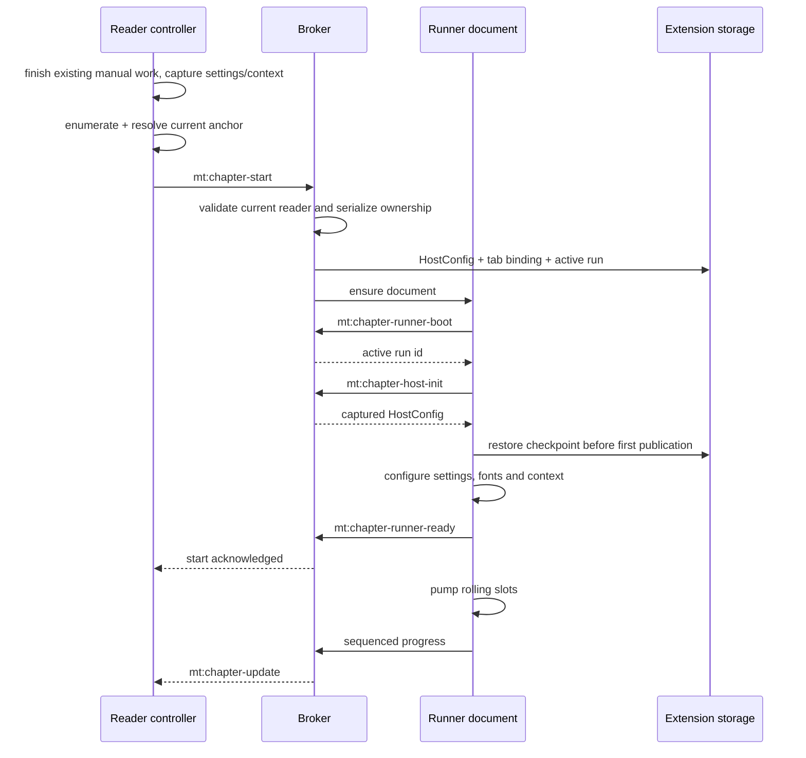
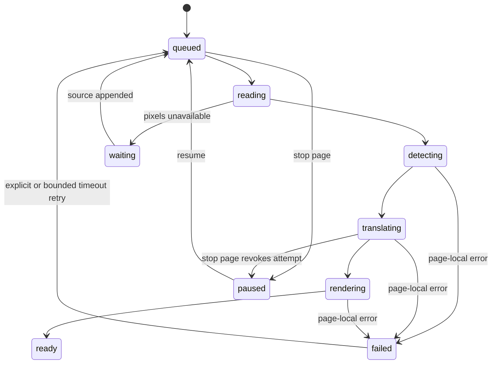

# Chapter translation

English | [ภาษาไทย](th/chapter-translation.md)

[Index](README.md) · [Previous: Reader integration](reader-integration.md) · [Next: Inference](inference.md)

## 1. Components

Chapter work runs outside the reader document so it can survive reloads and
navigation. The reader discovers pages and displays results; the broker owns the
session and the runner executes it.

| Component | Responsibility | Source |
| --- | --- | --- |
| Reader controller | Enumerate, resolve current anchor, start/control and match results to DOM | [sweep.ts](../src/content/sweep.ts) |
| Background broker | Authenticate session ownership, serialize lifecycle, boot runner and relay results/status | [chapter-broker.ts](../src/background/chapter-broker.ts) |
| Runner adapter | Chromium offscreen versus Firefox hidden iframe | [runner.ts](../src/chapter/runner.ts) |
| Runner pipeline | Prepare, group, translate, render, save and publish | [page.ts](../src/chapter/page.ts) |
| Model / protocol | Page list, progress, HostConfig, artifacts and signatures | [model.ts](../src/chapter/model.ts), [protocol.ts](../src/chapter/protocol.ts) |
| Scheduling / lease | Select groups and revoke expired attempts | [plan.ts](../src/chapter/plan.ts), [lifecycle.ts](../src/chapter/lifecycle.ts) |
| Persistent stores | Separate artifact/checkpoint and debug-log databases | [store.ts](../src/chapter/store.ts), [log-store.ts](../src/chapter/log-store.ts) |

Internal symbols/messages still use `sweep`; the user-facing feature is Translate to chapter end.

## 2. Start protocol

Scheduling waits for configuration. Priority hints received during setup must not
launch detection with default settings. The broker waits for readiness and permits
one fresh-context retry after failed attachment.

### Start scope

- A new start begins at the viewed page, not necessarily the chapter head.
- An unresolved current anchor reports a reason rather than guessing page 0.
- Resume continues the remaining work of the old run, not a new anchor at the current view.
- Completed reader translations can seed the run to avoid duplicate work.
- Opaque canvas/blob images may need captured bytes before the reader document disappears.

## 3. One active runner, multiple tabs

One chapter runner is active in this extension instance. Starting in another tab
retires/pauses the previous session and transfers ownership rather than letting
both tabs compete for the same document.

The broker stores per-tab `mtChapterTab:<tab>` bindings and the `mtChapterActive`
session. Commands/publications must belong to the current owner; possession of a
run id alone is insufficient. Start/close/clear share a serialized lifecycle chain.

Reader reload does not immediately close the runner, but closing the **current
owning tab** does stop it by policy. Closing a displaced old tab must not kill the
new owner's run. Checkpoints/artifacts support recovery, not a promise to resume
automatically after browser restart without user intent.

## 4. Rolling slots and merged pages

- `parallelLlm`: concurrent **work sets/slots**, clamped to 1–6 in the runner.
- `mergePages`: **pages per set** to attempt in one translation request, clamped to 1–10.

For `parallelLlm=2`, `mergePages=3`, two sets of up to three pages may be preparing,
translating or rendering. A freed slot starts its next set immediately, without
waiting for a whole wave. This is not a global cap on every HTTP call: fallback
and per-region reading can add another request structure.

### One slot's work

1. Choose queued pages by order/priority and claim phases synchronously.
2. Capture context before the group's first page at slot start.
3. Prepare each page: artifact reuse → source → hash → full cache/checkpoint → detection/order.
4. Render/commit cached translations immediately, without waiting for their group's LLM.
5. Restore page order among pages needing fresh translation before combining them.
6. Combine pixels into a working bitmap, shifting boxes/clips/balloon geometry by offsets.
7. Call `translateRegions` once for the group, then split outputs back by box offsets.
8. Render/save each page, add its context contribution and publish its ready revision.

Page mode still sends **one annotated full-page image per page** before the crops.
It does not use the entire tall working bitmap as unsegmented full-page context.
Badges use group-global ids; chunk retries use mapped request-local region ids.

Extras are disabled in merged requests because additional coordinates lack safe
page attribution. The single `<names>` block is folded with the last page in the group.

### Parallel-context trade-off

Simultaneously started slots cannot see answers that other slots have not committed.
New slots see earlier committed contributions. More concurrency can reduce latency,
but does not provide sequential narrative context. Merging gives the model shared
context within a group at the cost of larger payloads and decoded-image residency.

## 5. Progress state machine

This abbreviates per-page phases; cache/artifact/no-text paths can jump to `ready`.
Run phases are `running`, `waiting`, `stopping`, `stopped`, `complete` and `error`.
`complete` means the known walk ended, not that error count is zero. `waiting` can
mean incomplete discovery or pixels still dependent on the reader.

`publish` derives done/errors/inflight from page states and increases a monotonic
`sequence`. Restore must preserve it; old polling must not replace newer pushes or
local Stop intent. A progress push must not cause a priority echo/publication feedback loop.

## 6. Stop, leases and retries

Stop increments the run epoch, cancels attempts and disconnects live translation
RPCs. A late result from an old epoch/page attempt cannot commit even if its inner
promise eventually resolves. Draining can pass through `stopping` to `stopped`.

`Attempt` leases slow work independently of inference-RPC/HTTP deadlines. A single
page timeout must free a slot rather than stall the chapter. Group lease expiry or
combine/translation failure can fall back to individual page attempts, each with its own lease.

| Failure | Handling |
| --- | --- |
| Source pixels unavailable | Page `waiting`, pending append/capture |
| Page-local error | Mark failed and continue other pages |
| Timeout-class page failure | One automatic end-of-walk retry per page id per active runner session |
| Auth / 429 | Page error handling pauses shared work; adapter blocks repeat 429 requests during its refusal window |
| Confirmed browser-wide GPU non-response | Shared inference halt, not retries across every page |
| Persistence/publication failure | Surface fatal/progress error, not apparently healthy ongoing work |

Stop prevents late commits and further provider dispatch. Requests already accepted
by a provider may still finish; earlier cache/checkpoint writes may remain.

## 7. Artifacts, translation cache and attachment

[ChapterArtifact](../src/chapter/protocol.ts) contains a rendered Blob, entry, image
identity, source hash and signature. It lives in `mt-chapter`, separate from the
`mt-cache` translation store. Artifact keys are `result:<run-id>:<page-id>`;
checkpoint/config/status use separate record keys.

After ready progress, the reader:

1. Resolves the current element to a chapter page using URL/manifest/verified pixels.
2. Requests evidence/artifact through its tab/chapter-scoped broker.
3. Checks run/page revision, image identity and signature using [attach-policy.ts](../src/content/attach-policy.ts).
4. Adapts rendition/rendering only from verified data, not cleanup crops belonging to different pixels.
5. Creates reader `PageState` and writes through `writePage`.

During an active run, its ready revision has authority under attach policy. After
the run ends, normal current-settings compatibility applies again.

## 8. Settings and diagnostics

The runner uses a start-time pipeline snapshot. Relevant saved translation/model
changes detected by the broker pause/mark it stale; start a new run for new settings,
not Resume on the stale one. `prefetchN`, `cacheMax` and `showToasts` are non-pausing
exceptions. Popup Context is a separate command affecting the next work set, not
the snapshots of already dispatched requests.

The active pump retains the local inference host across long LLM waits to avoid
model unloading. Retaining does not create an iframe, so Cloud/cache-only paths
need not boot ORT.

Structured chapter logs are recorded only with Debug enabled. Popup reads
`mt-chapter-logs` directly even when the runner cannot respond; see
[Data](data-and-settings.md) for schema/retention.

## 9. Tests

- [chapter-startup](../tests/chapter-startup.test.mjs): configure-before-pump and restore ordering
- [chapter-broker-state](../tests/chapter-broker-state.test.mjs): session ownership and tab handoff
- [chapter-merge-order](../tests/chapter-merge-order.test.mjs), [chapter-order](../tests/chapter-order.test.mjs): grouping/output order
- [chapter-auto-retry](../tests/chapter-auto-retry.test.mjs), [chapter-watchdog](../tests/chapter-watchdog.test.mjs): bounded recovery
- [attach-policy](../tests/attach-policy.test.mjs), [state-sync](../tests/state-sync.test.mjs): attachment authority and stale publications
