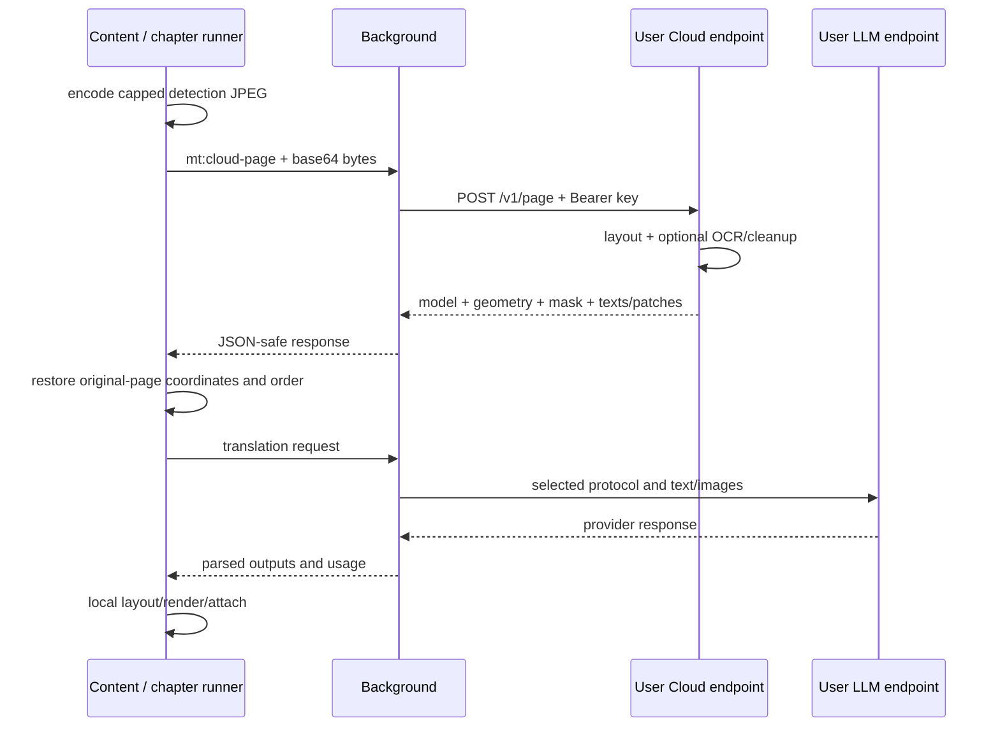

# Cloud inference and security boundaries

English | [ภาษาไทย](th/cloud-and-security.md)

[Index](README.md) · [Previous: Data and settings](data-and-settings.md) · [Next: Development](development.md)

## 1. Server responsibilities

The optional server runs KoharuLayout detection by default (or selected CTD), Baberu
OCR and Manga-LaMa cleanup. It does not own the character book, translation LLM,
text fitting or DOM output. Local mode needs no such server and does not
silently upload work to Cloud as a fallback.

Cloud/cache-only startup does not create a local ORT iframe. Decoding, verification,
crops/encoding and rendering still run in the browser.

## 2. Server modules and environment

| Source | Responsibility |
| --- | --- |
| [app.py](../server/app.py) | FastAPI endpoints, model loading, CTD/OCR/cleanup recipes and inference lock |
| [koharu.py](../server/koharu.py) | Pinned FP32 validation, native-compatible preprocessing and instance decoding |
| [split.py](../server/split.py) | Detection split/crop/mask helpers and split generation |
| [balloon_surface.py](../server/balloon_surface.py) | Physical text-surface refinement before OCR |
| [models_manifest.py](../server/models_manifest.py) | Model-source metadata for setup scripts |
| [serve.py](../server/serve.py) | Standalone launcher and optional Bearer middleware |
| [modal_app.py](../server/modal_app.py) | Modal deployment image/providers/secrets and auth wrapper |
| [Dockerfile](../server/Dockerfile) | CPU image with baked-in weights |

`MODEL_DIR` defaults to `/models`; standalone provider default is
`ORT_PROVIDERS=CPUExecutionProvider`. Modal source configures CUDA→CPU, Python 3.12,
a CUDA runtime image and `onnxruntime-gpu==1.30.0`. Check the active session providers
in `/health` or logs.

Most `server/requirements.txt` and Docker pip dependencies are unpinned, unlike the
extension lockfile. Notebooks are generated by [make-colab.py](../scripts/make-colab.py),
not edited directly. See [server setup](../server/README.md); verify current hosting
quota/pricing before deploying.

## 3. HTTP contracts

### `GET /health`

Returns `ok`, `device`, `layoutModel`, `layoutModels`, `layoutRecipe`, `modelSha256`,
`panels`, `ep`, `splitGen`. `ok` reflects loaded Koharu/Baberu, not key acceptance or
optional cleanup readiness. `panels` identifies Koharu panel inference. Wrappers intentionally exempt root/health from Bearer
checks for Test/warm.

### `POST /v1/page`

- Body: raw image bytes; extension uses `Content-Type: image/jpeg`.
- Query: `layout_model=koharu` (default) or `ctd`, `min_size`, Koharu `text_conf`/`sfx_conf`/`bubble_conf`/`panel_conf`, CTD `conf_thr`, optional `texts=0`, `inpaint=1`, `pad_ratio`.
- Reply: model identity, `ok`, `w`, `h`, boxes/clip/cutAxis, panels, balloon shapes, `texts`, packed mask, split generation, timings and optional indexed PNG patches.
- `texts[i]` belongs to `boxes[i]` before client reordering.
- `texts=0` skips Baberu when the translation LLM reads images.
- `inpaint=1` attempts cleanup in the same round trip; failed cleanup may yield empty patches while detection succeeds.
- Koharu panels guide client ordering; CTD and tiled strips use text-position banding. Cloud never downloads local YOLO.
- Koharu response recipe/hash must match the extension. Old or mismatched servers fail explicitly, never populate Koharu cache with CTD results.

### `POST /v1/inpaint`

JSON contains `image` base64 pixels, `boxes` and optional `mask` base64 grayscale
PNG. Mask dimensions must match the image: mismatch is 400; unavailable cleanup
model is 503. Replies contain coordinate-tagged base64 PNG patches, window count
and timings. This path handles unusable detect-time patches, such as keep-overlap
or incomplete coverage.

A shared asyncio lock bounds inference within one process, not across distributed replicas.

## 4. Coordinate spaces

`cloudDetect` caps the **detection upload** long side at 1600 px and records
`originalLongSide / uploadedLongSide`. Server geometry is in uploaded-image space;
the client restores boxes, panels, clips and patch rectangles to original-page coordinates.
Upload-resolution patch PNGs are scaled into their destination rectangles.
Balloon row spans retain their source dimensions for proportional layout lookup;
they remain separate from the text/SFX erase mask.

Packed masks are unpacked to original dimensions. Legacy responses without masks
have a compatibility fallback, but reuse still requires the client's minimum split generation.

The dedicated `/v1/inpaint` path sends the page JPEG and prepared erase mask at
matching resolution without detection's 1600 px cap. Any resizing must scale the
image, mask and boxes together.

## 5. Deadlines and error semantics

| Operation | Background request cap | Caller wait |
| --- | --- | --- |
| Cloud health Test | 120s | Options-test path |
| Chapter warm | 180s | 190s |
| Cloud detect | 90s; 150s with inpaint | 160s |
| Dedicated cleanup | 90s | 100s |

Caller waits exceed request caps for message/encoding/response overhead, but can
also expire when background never receives the call. Chapter receipt events separate
sent→received→HTTP start→HTTP reply→response instead of assuming every delay is server time.

Cloud detection failures report `kind:'cloud'` without local fallback. Cleanup
failures can use built-in fill so rendering can continue.

## 6. Authentication and deployment exposure

- `serve.py` installs Bearer middleware when `ARN_API_KEY` is set; otherwise it warns and runs unauthenticated.
- Bare `uvicorn app:app` does not install that middleware, even with the key exported.
- Modal's wrapper reads secret `ARN_API_KEY`, checking every path except root/health.
- The current Dockerfile launches bare `uvicorn app:app`; add authentication/reverse-proxy protection before public exposure.
- Health success does not validate a key. Verify an authenticated operation too.

Use HTTPS across untrusted networks; HTTP endpoints are unencrypted. Keep real keys
out of example URLs, shell history and committed configuration.

## 7. Outbound data depends on workflow

| Destination | Relevant data |
| --- | --- |
| Translation endpoint | Page/crop images or OCR text, prompts, selected character/context data and its credential |
| Separate VLM reader | Transcription images and reader credential; possibly a different provider |
| Cloud inference | Page pixels, detection parameters and possibly cleanup masks/boxes, not just text crops |
| Public model/font mirrors | Asset-download requests, not comic uploads to obtain weights |
| Reader image/API hosts | Source/manifest/API fetches for the integration |

Keys are stored in `chrome.storage.local` and sent to endpoints for authentication.
Anyone with browser-profile access may read them. Provider policies govern retention,
training and billing. See the [Privacy policy](../PRIVACY.md).

## 8. Extension trust boundaries

### Inference iframe

Its web-accessible document requires a secret RPC token to prevent page scripts from
requesting downloads, deletion or compute. The client checks source/origin/frame generation.
This does not protect against a compromised renderer.

### Image fetch proxy

`fetchImageBlocked` checks requested and final `resp.url` values before returning
bytes, restricting schemes/private/loopback hosts by requester policy. This URL/
readback guard is not a DNS-aware firewall or a promise that no redirect-target
request occurred before the response check. User-configured LLM/Cloud endpoints
are a separate capability from image URLs planted in the reader DOM.

### Screenshot

ActiveTab gesture and active-sender/window checks prevent background jobs from
capturing another tab. Screenshots contain on-screen data and must be cropped to
the page, not treated as a background collection loop.

### Storage / chapter messages

Cache payloads are chapter-scoped; runner publications/controls require current
ownership. Chromium uses non-tab extension-document identity; Firefox uses a broader
non-tab extension-context check.

## 9. Limits and security verification

Structured chapter events whitelist fields without raw images/text/keys/URLs.
Console prompts, timing reports and errors do not all have that guarantee. Review
credentials, endpoint query parameters, source text and reader identifiers before sharing.

Host permissions/CSP do not replace input validation or memory/request bounds.
Public deployments need abuse controls, TLS, authentication and resource limits.

Tests: [cloud](../tests/cloud.test.mjs), [host-access](../tests/host-access.test.mjs),
[worker-token](../tests/worker-token.test.mjs), [worker-handshake](../tests/worker-handshake.test.mjs),
[cache-transport](../tests/cache-transport.test.mjs), [test_inpaint_mask.py](../server/test_inpaint_mask.py).
