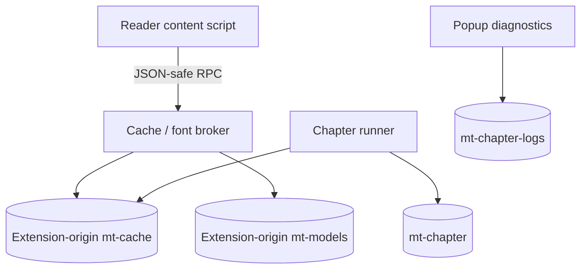

# Data, settings and state synchronization

English | [ภาษาไทย](th/data-and-settings.md)

[Index](README.md) · [Previous: Rendering](rendering.md) · [Next: Cloud and security](cloud-and-security.md)

## 1. Storage

Translations use shared extension storage. Credentials, models and books have
separate lifetimes and survive Clear translations.

| Storage | Examples | Lifetime / access |
| --- | --- | --- |
| `chrome.storage.local` | `mtSettings`, `mtOcrSettings`, `mtPipeline`, `mtDebug`, `mtTheme`, Auto sites, `mtBook:*`, overrides, cache generation | Browser-profile persistence, not a server account |
| Session wrapper | `mtCtx:*`, `mtShare:*`, `mtChapterActive`, `mtChapterTab:*`, ledger, worker tokens | Browser session when supported; context-local memory fallback |
| IDB `mt-models`, `m`, v1 | CTD/panel/cleanup, Koharu key, `baberu:*`, `tess:*`, `font:*` | Shared extension-origin model/font bytes |
| IDB `mt-cache`, v2 | `pages` payloads and `metadata` | Full translations, aliases and partial checkpoints |
| IDB `mt-chapter`, v1 | `records`: host/config/status/checkpoint/artifact/error | Chapter execution state/results |
| IDB `mt-chapter-logs`, v1 | `heads`, `events`, `pages` | Bounded Debug-only structured diagnostics |
| Reader memory | Page registry, bitmaps/Blob URLs, bindings/indexes, queue | Document lifetime; owned resources must be released |
| Background memory | In-flight/recent LLM replies, learned capabilities, refusal windows | Lost on background restart |
| Reader sessionStorage markers | Warming/LLM progress timestamps | Continuity hints, not translations or permission to start work |

## 2. Reader versus extension-origin IndexedDB

A content script's `indexedDB` belongs to the reader origin, not the extension.
Cache/font bytes use brokers; runner/options/inference documents can share the
extension-origin stores directly. [wire.ts](../src/cache/wire.ts) preserves binary
data across Chromium's JSON runtime transport.

Cache get/put/delete scope follows the browser-attested reader chapter.
[sender-url.ts](../src/cache/sender-url.ts) prefers the live tab URL over injected
`sender.url`, since SPA navigation can change chapters within one document.
Global cache counts are aggregates, not permission to read another chapter's payloads.

## 3. Two translation identities

- `chapter#hash`: decoded original-pixel rendition, owning detection/OCR checkpoints and cleanup crops.
- `chapter@pN`: logical page slot, a **candidate lookup**, not proof of the displayed image.

The hash uses a 48×48 grayscale sample and cyrb53-style hashing, not SHA-256 of the
original file. The code's “bytes key” means pixel-rendition identity, not cryptographic
byte equality.

Slot hits require recipe/completeness gates and page/region image evidence, not
dimensions/aspect ratio alone. Verified proportional renditions scale boxes, clips,
panels and extras together. Drop another rendition's cleanup crops and derive them
from current original pixels. See [Translation cache](cache.md) for lookup/transaction details.

## 4. Full results versus checkpoints

`CachedPage` can be complete or `partial: true`:

| State | Purpose | User-visible completion |
| --- | --- | --- |
| Detection checkpoint | Reuse ordered boxes/mask after later failure | Not a translated page |
| OCR checkpoint | Add reusable source strings to detection | Still not a translation |
| Full result | Outputs/extras/mentions, geometry/mask, optional cleanup patches | Must render/attach before reading |
| Chapter artifact | Rendered Blob, entry and associated identity/signature/revision | Attach only with matching evidence |

`cacheEnabled` governs full translation reuse/storage, not in-flight checkpoints.
Successful cache-off work removes its completed checkpoint. Late partial writes
must not replace full results of the same recipe/dimensions; detection-only writes
must not strip OCR text from richer checkpoints.

## 5. Fingerprints and generations

### Translation fingerprint

[settingsFingerprint](../src/cache/policy.ts) includes text-affecting inputs/behavior:
target language, textSource/OCR, detector/order, prompt/context options, image
encoding/sizing, thinking/temperature and `mergePages`. Koharu adds its recipe/hash/
thresholds while maintaining the implementation's CTD fingerprint compatibility.

Font/color/size, cleanup, concurrency, capacity and provider/model changes preserve
cached translations. Use Re-translate to obtain a new model's answer. Growing
book/context contents also leave earlier cached pages valid.

### Current recipe versions

| Control | Source-baseline value | Scope |
| --- | --- | --- |
| Fingerprint recipe suffix | `tile40` | Translation/detection/prompt compatibility |
| `RENDER_GEN` | 47 | Rendered artifact/layout compatibility |
| `CLOUD_SPLIT_GEN` / Python `SPLIT_GEN` | 18 / 18 | Cloud split/mask freshness |
| `INPAINT_PATCH_GEN` | 5 | Cleanup crop recipe |
| `PAGE_KEY_GEN` | 1 | Logical page-key evidence format |

Version definitions: [cache/policy.ts](../src/cache/policy.ts), [render.ts](../src/content/render.ts)
and [server/split.py](../server/split.py). Model digests, image identity generations
and `chapterSignature` add separate compatibility checks.

## 6. Retention, transactions and Clear

Capacity counts **logical completed pages**, grouping slots and rendition aliases.
LRU eviction removes whole groups; checkpoints have their own allowance. Payloads
share an estimated 256 MiB limit, not a browser RAM budget. Small metadata rows
support counting/eviction without loading all image payloads.

Writes complete at transaction commit, not individual `put` success. Read touches
update metadata, never writing an old payload over a newer result. Some storage
writes are best effort, but transport read errors must be reported rather than
treated as misses that trigger another LLM request.

Clear translations coordinates:

1. Persist/accept a new `mtCacheGeneration`.
2. Stop the active chapter lifecycle and remove related artifacts/bindings.
3. Clear the shared translation cache.
4. Notify readers to restore originals and release page state.
5. Require old pending work to recheck generation before using/writing its results.

Changing the generation revokes old work so pending answers cannot repopulate the
cleared cache. Models, credentials and character books remain intact.

## 7. Settings schema, defaults and drafts

[pipeline-settings.ts](../src/llm/pipeline-settings.ts) owns schema/defaults/presets/
defensive loading. Do not duplicate policy independently in UI, host or cache code.

Defaults:

| Setting | Value |
| --- | --- |
| Inference / layout | `local` / `koharu` |
| Cloud layout default | `koharu` when no explicit choice exists |
| Text source / local OCR | `crops` / `baberu` |
| Target / reading direction | `Thai` / `rtl` |
| Cleanup | `auto`: local fill, Cloud AI |
| Context / characters / cross-chapter | Enabled |
| Pairs / learned-roster target | 15 / 10 |
| Parallel sets / pages per set | 1 / 3 |
| Pages ahead / full-cache maximum | 3 / 200 |

These initialize new/partial settings and preserve explicit saved choices.
Cloud Koharu requires an updated server with matching model recipe/hash; explicit saved CTD choices remain intact.

Options implements drafts/save/discard:

- Editing must not immediately persist every field.
- Save requests host access in the click task before async work can lose Firefox's gesture.
- Discard reloads saved state.
- Debug/theme and some management actions apply immediately under their own UI contract.
- Presets change owned tuning without resetting language/font/workflow/context preferences they should preserve.

## 8. Settings during active work

Reader `loadPipeline` fences settings loads by revision. Font loading and family
application are separate: cached fonts still need reapplying after configuration,
and late font/settings reads must not replace newer choices.

Chapter captures a snapshot at start. Relevant translation/model/provider changes
pause/mark the run stale and require a new start. `prefetchN`, `cacheMax`, `showToasts`
and `preset` metadata are non-pausing under [chapter/settings.ts](../src/chapter/settings.ts).
Popup Context is a separate next-work-set command.

Translation fingerprint and chapter signature differ. A font/cleanup change can
reuse cached text while requiring a new rendered image. See
[protocol.ts](../src/chapter/protocol.ts) and [attach-policy.ts](../src/content/attach-policy.ts).

## 9. Race guards

| Guard | Race it prevents |
| --- | --- |
| Cache epoch | Pre-Clear work returning to storage/display |
| Run id + active owner | Old runner/tab controlling a replacement owner's run |
| Progress sequence | Late polls/publications replacing newer snapshots |
| Local intent revision | Old acknowledgements overriding newer Stop/Resume |
| Page revision / attempt epoch | Old work committing after retranslate/stop-page |
| Iframe generation/source | Dead-frame ready/token lookup binding a replacement |
| Pipeline/story-load revision | Old settings/story reads replacing current chapter state |

`isConnected` checks DOM presence only. Source identity and session authority need
their own checks. Popup accepts the newest authorized completed reply without
waiting for a newer issued poll that may be slow.

## 10. Session fallback and diagnostics

[storage-session.ts](../src/storage-session.ts) wraps session get/set/remove. Missing/
denied APIs fall back to nonthrowing memory. That memory is context-local, not a
fully equivalent persistent/shared browser session.

Chromium's runner loads classic [shim.js](../src/chapter/shim.js) before module
evaluation to fill missing storage pieces and proxy runtime calls. Its `onChanged`
is a no-op; the broker relays important settings changes as commands.
The shim uses raw `runtime.sendMessage`; some offscreen storage awaits have no deadline.

Debug chapter logs use whitelisted event/counter fields and small separate rows:
3 runs, 1200 events per run, page rows through ordinal 2048. Public report schemas
omit raw chapter URLs/keys/text/images. Raw console/page-result logs may contain
translated text/prompts and still need review before sharing.

Tests: [cache-store](../tests/cache-store.test.mjs), [cache-transport](../tests/cache-transport.test.mjs),
[cache-generation](../tests/cache-generation.test.mjs), [settings](../tests/settings.test.mjs),
[quality-presets](../tests/quality-presets.test.mjs), [state-sync](../tests/state-sync.test.mjs),
[chapter-log](../tests/chapter-log.test.mjs).
