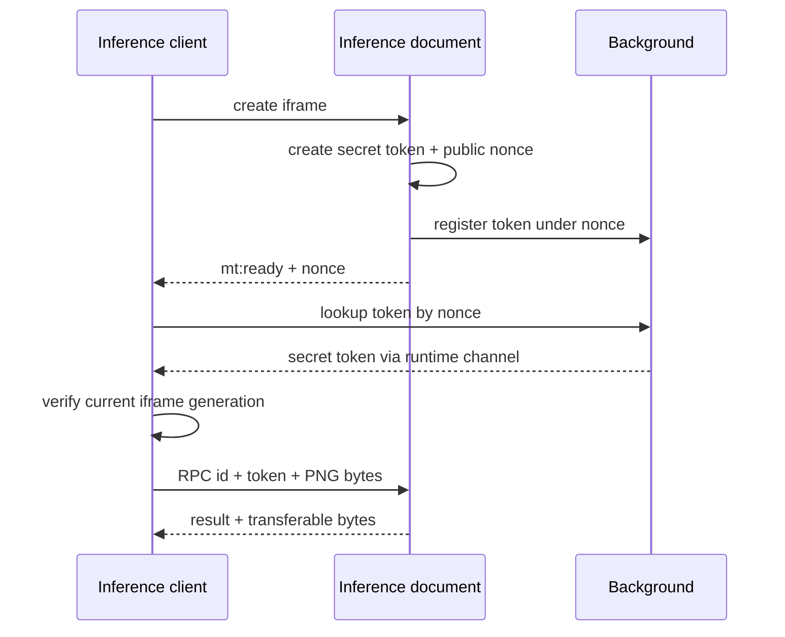
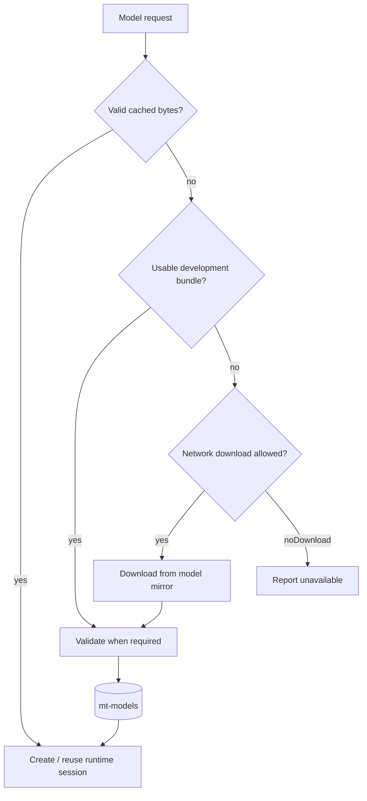

# Inference and model lifecycle

English | [ภาษาไทย](th/inference.md)

[Index](README.md) · [Previous: Chapter translation](chapter-translation.md) · [Next: LLM and context](llm-and-context.md)

## 1. Host lifecycle

[iframe/worker.ts](../src/iframe/worker.ts) executes in extension-origin
[worker.html](../src/iframe/worker.html), where it loads packaged runtime/WASM and
uses canvas preprocessing. It is an iframe document, not a `new Worker()`.
Content/runner callers use [detection.ts](../src/content/detection.ts).

The host starts only for actual local RPCs, not Cloud/cache-only startup. Setup,
encoding and active RPCs hold resource leases; the chapter pump retains it throughout
active work. Idle disposal happens after ownership ends. See
[memory ownership](performance.md) for browser memory-reclamation limits.

## 2. Handshake and RPC

Page JavaScript and content scripts share the page origin for postMessage purposes.
Checking request origin alone cannot distinguish a hostile page from our caller.

The worker accepts matching-token requests; the client checks source window and
extension origin. A ready/token lookup must be discarded if the iframe changed
during the await. Registration is nonce-keyed, not `sender.tab`-keyed, because
runner/extension documents may have no tab.

Handshake has a deadline and bounded missing-token healing. RPC timeout destroys
the computing frame and rejects pending siblings, not just that call's callback.
[inference-health.ts](../src/content/inference-health.ts) distinguishes worker timeouts
from browser-wide GPU non-response.

## 3. Models and execution providers

| Work | Model / input | Local execution | Notes |
| --- | --- | --- | --- |
| Default layout | KoharuLayout FP32, 1152×1152 | WebGPU; WASM session-create fallback | Text/SFX/bubble/panel model; Cloud uses the same export |
| Alternative layout | CTD dynamic INT8, 1024×1024 letterbox | WebGPU; WASM session-create fallback | Boxes and text-probability mask |
| CTD panel order | YOLO26n, resize 640×640 | WASM | Class 0; graph already performs NMS |
| OCR | Baberu vision 224×224, prefill and step | Vision WebGPU→WASM; decoders WASM | Requires all model files and vocab |
| Alternative OCR | Tesseract.js | Packaged worker and WASM | Installed language traineddata |
| AI cleanup | Manga-LaMa FP16 weights, 512×512 windows | WebGPU only | Renderer can fall back to built-in fill |

`detEp='wasm'` forces the layout detector's CPU provider, not every other model.
Local AI cleanup still requires WebGPU.

The WASM runtime sets `ort.env.wasm.numThreads = 1` because this host is not
cross-origin isolated. More page concurrency does not make its WASM inference multithreaded.

## 4. KoharuLayout path

[layout-model.ts](../src/layout-model.ts) defines the supported artifact:
`koharu-fp32-q256-v3`, `koharu-fp32-chunked.onnx`, 149,799,163 bytes. Both exact size
and SHA-256 must match; a matching filename is insufficient.

[koharu.ts](../src/iframe/koharu.ts) handles preprocessing and output geometry:

1. RGB float antialiased bilinear resize, preserving relevant FP32 arithmetic.
2. ImageNet normalization and NCHW `[1,3,1152,1152]` input.
3. Output dimension/length/finite-value validation:
   `dets=[1,300,4]`, `labels=[1,300,5]`, `masks=[1,300,288,288]`.
4. Sigmoid class scores, candidate selection and thresholds.
5. Combined text/SFX instance masks; bubble/panel masks never become erase ink.
6. Bubble row spans preserving holes/disconnected pieces for layout.

Detecting SFX does not authorize erasing/translating it all; translation/render still
decide `keep`. Extreme-aspect pages use shared tiling with panel fallback, because
tile panels do not describe full-page topology.

Switching Koharu↔CTD/panel uses a layout lock around session borrowing/release, so
switching cannot release a session still used by another page/tile. Koharu and
CTD/panel sessions are not retained together unnecessarily. See
[Koharu export/install](koharu-layout.md) for recipes and licensing.

## 5. CTD, tiling and reading order

CTD preserves aspect ratio with a 1024 letterbox, producing box-head predictions
and a probability mask. Postprocessing combines confidence/NMS, connected components,
grouping/splitting and mask recovery to separate merged groups and reduce fragments
that would produce duplicate lettering.

Pages with aspect ratio above 3 on either axis use tiles targeting 1200 px with
180 px overlap. Boxes/masks merge back into page coordinates. Compare output geometry
when changing this recipe.

Panel output `[1,300,6]` already has graph NMS; use class 0 and the configured
threshold. `orderDetection` avoids the panel model for strips whose 640 resize
would destroy geometry, and falls back to text-position banding for unusable panels.

Split/grouping/mask changes require updating the Python mirror and reviewing cache generations.

## 6. OCR

### Baberu

Files include vision, prefill, step and vocab. The model manager prepares them in
`mt-models`; `baberuInstalled` checks readiness rather than downloading every OCR call.

Crops expand enough to preserve edge glyphs from original pixels. Baberu reads
vertical text without Tesseract-style rotation/binarization. Decoding is greedy
with repetition penalty 1.2, content-run cap 12 and at most 128 steps.

Bounded crop prefetch overlaps crop/encode/message work. ONNX execution still uses the inference lock.

### Tesseract

Engine/worker scripts and SIMD-LSTM core are copied from dependencies into the
extension. Only language data comes from public mirrors. Explicit packaged paths
and `workerBlobURL: false` avoid a blob wrapper inheriting page CSP that blocks
extension script loading.

## 7. Locking and priority

`withInferLock` is a shared ORT queue **inside one inference document**, covering
shared session create/run/release work. Foreground priority 0 precedes background
priority 1 without preempting an already running task. Decode/preprocess/postprocess
need not hold it throughout. `withLayoutLock` separately protects layout-model switches.

Keep timing categories distinct:

- Initialization includes model upload/shader compilation.
- An elapsed inference wrapper may include lock wait.
- Cumulative lock-wait deltas are not isolated kernel timings under contention.
- Total page time also includes CPU pixels/layout/PNG encode and LLM network time.

## 8. Model storage, download and repair

Normal source order is IndexedDB → optional development bundle → mirror. Release
builds omit ONNX weights, not required executable runtime/WASM. `noDownload` forbids
remote model downloads but can still use a local development bundle.

- [ocr-models.ts](../src/llm/ocr-models.ts): shared model/data downloads, stall detection and bounded retries.
- [layout-models.ts](../src/llm/layout-models.ts): exact Koharu size/hash, import, download and integrity repair.
- Forced fresh downloads bypass stored bytes/HTTP cache and commit replacement bytes after readiness.
- Koharu repair responds specifically to integrity errors, not every crypto/runtime exception.
- CTD/panel/Baberu validators differ from Koharu's exact size/SHA-256 check.
- Delete removes persisted installations, not optional weights built into the extension package.

## 9. References and tests

- [ONNX Runtime WebGPU EP](https://onnxruntime.ai/docs/execution-providers/WebGPU-ExecutionProvider.html)
- [Environment flags and session options](https://onnxruntime.ai/docs/tutorials/web/env-flags-and-session-options.html)

Tests: [worker-handshake](../tests/worker-handshake.test.mjs), [inference-host](../tests/inference-host.test.mjs),
[worker-resources](../tests/worker-resources.test.mjs), [koharu](../tests/koharu.test.mjs),
[koharu-model-store](../tests/koharu-model-store.test.mjs), [model-download-repair](../tests/model-download-repair.test.mjs).

For browser checks, inspect the effective provider, decoded pixels, finite model
output and rendered image on the target device.
