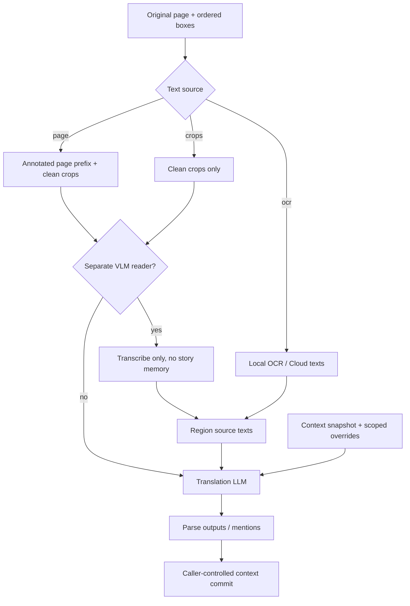

# LLM, prompts and context

English | [ภาษาไทย](th/llm-and-context.md)

[Index](README.md) · [Previous: Inference](inference.md) · [Next: Rendering](rendering.md)

## 1. Domain logic versus transport

| Module | Responsibility |
| --- | --- |
| [content/ocr.ts](../src/content/ocr.ts) | Source reading, page/crop payloads, chunk mapping and translation RPC |
| [background.ts](../src/background/background.ts) | Endpoint settings, overrides, retry/dedup, optional VLM-reader stage and replies |
| [llm/core.ts](../src/llm/core.ts) | Pure prompt building, parsing, character matching/merge and context updates |
| [llm/adapters.ts](../src/llm/adapters.ts) | Protocol-specific HTTP and normalized text/usage/errors |
| [chapter-context.ts](../src/background/chapter-context.ts) | Serialized context persistence and chapter-contribution replay |

Transport uses fetch directly. Each selected endpoint receives its credential and
workflow inputs; no developer backend holds the keys.

## 2. Text-source contract



In `page`, the model reads **crops** and uses annotated pages for context/speaker
cues. Annotation numbers are not comic text to translate. `crops` has no surrounding
artwork, reducing speaker evidence. `ocr` sends no images in the translation call,
but Cloud or a separate reader may still receive images in an earlier stage.

## 3. Regions, markers and image positions

Region numbers and payload positions have separate meanings:

| Value | Meaning |
| --- | --- |
| `RegionInput.index` | Output `n` required in this request |
| `page` | Region's full-page-image position in a merged request |
| `marker` | Annotated-page badge, stable during subset retries |
| Prompt `crop` / `image` | Actual payload position, not necessarily marker number |
| Mapped-back `RegionOutput.index` | Original page region used by the renderer |

For example, retrying regions 3 and 7 needs their corresponding two crops, not
array positions 3/7 in a two-image array. `subsetRegionImages`, `requestImages`,
`transcribeCropImages` and chunk-local→global mapping preserve that contract.

All full-page images precede crops in page mode. Per-region transcription fallback
must skip **pageCount** images, not always just the first image.

## 4. Prompt structure

`BuiltPrompt` separates `system` and `user`:

- `system`: task, output schema, completeness, language/style rules and image instructions.
- `user`: known characters, recent pairs, optional dimensions/content rectangle for extras, and regions.

Stable instructions precede the changing book/pairs/regions to support provider-side
prefix caching. Cache availability and pricing depend on the provider.

`useContext` and `useCharacters` independently include pairs/book; `shareContext`
can disable the entire snapshot for a job. `stylePrompt` adds tone guidance rather
than replacing completeness/numbering rules. Prompts do not use numeric space or
character budgets to force abbreviated meaning into the renderer.

OCR-text rows carry `b=1` for positive balloon evidence or `b=?` for unknown. This
is metadata, not source text or a definitive speech/SFX label. Spoken reactions
versus sound effects depend on meaning, not capitalization/script alone.

## 5. Response schema and parsing

Example with Thai as the target language:

```xml
<r n="1" spk="c1" g="F">ไปด้วยกันไหมคะ</r>
<r n="2" keep="true"/>
<names>
<m name="อากิ" g="?">เพื่อนร่วมชั้น</m>
</names>
```

- `n` is the request's 1-based region id; sparse retries must not compact numbering.
- `keep` preserves the original for cases such as unreadable regions, genuine SFX or watermarks under prompt rules.
- `src` is exact source transcription when requested, not an image summary.
- `spk` references a stable roster id, or `new` with a supported description.
- `<names>` contains page-level mentions, not necessarily region speakers.
- Merge/correction/note operations require evidence and must respect confirmed user rows.

The parser tolerates some preambles and self-closing/unclosed-tag drift, filtering
unusable indices/coordinates. It does not `eval` answers or display them as HTML.
Unparseable answers must not become successful empty cache entries. Missing or
unplaceable regions retain original text in rendering.

## 6. Provider adapters

Supported request formats; accepted options vary by endpoint:

| Provider id | HTTP shape | Images / instructions |
| --- | --- | --- |
| `openai` | `<base>/chat/completions` | image_url data URLs; system/user messages |
| `responses` | `<base>/responses` | input_image, `instructions`, output message items |
| `anthropic` | Messages API | Base64 image blocks, system and ephemeral cache segments |
| `gemini` | `<base>/models/<model>:generateContent` | Inline image data, systemInstruction |
| `cloudflare` | Account AI `/run/<model>` | Native run body, normalized result/errors |

See [adapters.ts](../src/llm/adapters.ts) for `baseUrl` overrides/defaults. `responses`
names a protocol, not a requirement to use OpenAI's host. Key placement differs
by adapter: Bearer, provider header or query parameter. Do not log full URLs/headers.

Temperature/thinking map to protocol-specific settings. Rejected supported-fallback
options may be omitted/transformed with bounded retries. The thinking test shows
**request acceptance**, not proof that a server applied that reasoning level.

Optional output caps are not universally defaulted across OpenAI-compatible,
Responses and Gemini; Anthropic/Cloudflare retain implementation-required values.
Do not add a generic max_tokens cap to fix empty replies without checking reasoning
usage and finish reason.

## 7. Retry layers

| Layer | Trigger | Bound / behavior |
| --- | --- | --- |
| Adapter compatibility | Applicable role/cache-key/thinking/temperature rejection | Change representation/omit option, not retry 429 |
| Background HTTP | Network/5xx | Up to two additional retries, 1s/4s backoff |
| Empty reply | HTTP success with empty text | One extra attempt in opt-in calls |
| Response completeness | Partial/failed parsing | Missing-only or full-parse retry according to path |
| Content chunking | Multi-region `parse` failure | Roughly halve batches, remember size for this script instance |
| RPC transport | Applicable disconnect/no-receiver/timeout | Bounded channel fallback, not arbitrary provider-error retries |
| Chapter group | Combine/group failure or lease expiry | Per-page fallback unless halted as a shared failure |

Actual HTTP calls can exceed page/group counts; attempts without usable answers
may still be billed. Accumulate provider-reported usage from discarded attempts
where the path supplies it, rather than inferring cost from completed pages.

Auth/quota/429 halt Auto/chapter work until user intent. The adapter tracks a refusal
window per provider/base URL.

Separate VLM reading starts batched, switching to one crop per call if forced or
the image cap is learned. Learned capabilities last for the background lifetime,
not a permanent model catalog. Interim transcripts allow checkpointing before the
long translation stage.

## 8. Request deduplication and prompt caching

The three caches operate at different levels:

1. **Full translation cache**: persisted page outputs matching source/recipe.
2. **In-flight/recent request dedup**: background shares identical request-fingerprint
   replies; successful recent replies are bounded to 5 minutes and 20 memory entries.
3. **Provider prompt cache**: endpoint-side prefix reuse according to protocol/model.

Request fingerprints include images, regions/context and relevant request settings.
Fresh Re-translate adds a nonce; cache generation distinguishes work after Clear.
Background restart loses in-memory dedup; duplicate billing remains possible.

Provider session/cache affinity uses a salted opaque identifier, not a raw chapter
URL session field. Selected translation/book/context content still reaches the endpoint.

## 9. Character book and recent pairs

`ContextState` has two parts:

- `pairs`: source/translation and optional speaker id for recent narrative flow; chapter-scoped.
- `characters`: stable id, description, gender, name/fullName, source, note and absorbed rows.

Unnamed people can be learned through visual/role anchors. Region speakers differ
from people mentioned in `<names>`. Crop-only/OCR evidence is limited; omit uncertain
speaker assignments rather than guessing.

Merge policy prioritizes user rows, preserves stable ids, does not invent full names
from pieces on different pages, and does not evict user rows just to enforce a cap.
`absorbed` preserves enough information for UI Split to restore merged rows.
User overrides are book-scoped before prompt use, not global replacements across stories.

`crossChapter` uses a resolved story key or fails safely to chapter scope. Pairs do
not follow the book across stories/chapters; see [Data](data-and-settings.md).

## 10. Ordered commit and replay

Translation replies propose next context; the caller decides when to commit:

- Reader queue: pre-page snapshot → translate/render → fold once; cache hits fold if not already incorporated in this session.
- Re-translate: restore bookBefore/pairsBefore or fallback replay to remove the old page's influence from its new prompt.
- Chapter: ledger contributions are keyed by page id/order; replace the old contribution, not append a duplicate.
- Concurrent completion: replay base plus contributions in reading order, then apply explicit edits.

Background context transactions serialize ledger read/modify/write, not all LLM
requests. Late chapter lookups or save revisions must not replace current context.

Tests: [llm](../tests/llm.test.mjs), [translate-retry](../tests/translate-retry.test.mjs),
[adaptive-chunk](../tests/adaptive-chunk.test.mjs), [thinking](../tests/thinking.test.mjs),
[ocr-balloon-hints](../tests/ocr-balloon-hints.test.mjs), [chapter-order](../tests/chapter-order.test.mjs).
