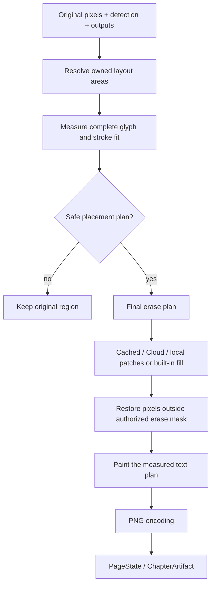

# Rendering, reading order and geometry

English | [ภาษาไทย](th/rendering.md)

[Index](README.md) · [Previous: LLM and context](llm-and-context.md) · [Next: Data and settings](data-and-settings.md)

## 1. Geometry types

Detection locates text groups, not necessarily safe free space for translations.
One box may span multiple balloons; multiple boxes may share one balloon. Translated
text has different length/proportions, so rendering measures original pixels and
keeps several geometries separate.

| Geometry | Purpose | Not interchangeable with |
| --- | --- | --- |
| Detection box | Text-group location, crops and numbering | Entire balloon interior |
| Text mask | Evidence of glyph-ink pixels | Unconditional permission to erase |
| Balloon surface | Background shape enclosing text | Erase mask or speech classifier |
| Ownership clip / cutAxis | Ownership of separated text groups | A real wall in the image |
| Layout area / row profile | Safe space for a text block | Cleanup's authorized pixel region |
| PreparedRender | Measured layout/glyph positions that pass fitting | A different measurement recipe at paint time |

## 2. Original-preserving flow

`paintRegions` in [pipeline.ts](../src/content/pipeline.ts) prepares layouts before
erasing. If complete glyphs/strokes cannot fit safely, preserve the source instead
of leaving a blank. Keep/missing regions and duplicates without a replacement plan
must not be erased indiscriminately.

## 3. Reading order precedes LLM input

Ordering runs before region numbering:

1. Use panel-aware ordering when panel geometry is usable.
2. Resolve panel topology, including nested/inset panels and undetected gaps.
3. Order text according to `readingDir`: RTL for manga, LTR for other reading directions.
4. With unsuitable panels/strips, use position bands and corridor splitting.
5. Optionally defer small clustered labels so they do not interrupt primary dialogue.

[detection.ts](../src/content/detection.ts) implements `sortReadingOrder`,
`orderByPanels`, `panelReadingOrder`, `splitDeferred` and `panelsUsable`. Ordering
sets region numbers/crops/prompts/context. Changing it after translation requires
remapping indices.

## 4. Physical balloon surfaces and text grouping

[balloon-surface.ts](../src/content/balloon-surface.ts) measures enclosed background
components using tone, flood fill, enclosure evidence and internal-divider checks.
Flood fill must not cross balloon walls through text pixels. Measure the physical surface
independently of artificial ownership clips, then apply ownership.

Surfaces support:

- Separating groups in different enclosures even if the first detection spans both.
- Merging lines only when geometry supports one text group, not proximity alone.
- Splitting connected/lobed interiors whose text blocks need separate layouts.
- Finding per-row free spans that follow curved outlines.

Cloud performs relevant grouping/refinement before server OCR. Splitting only
after recognized strings return would break text/region correspondence. Its Python
mirror is [balloon_surface.py](../server/balloon_surface.py).

## 5. Koharu model balloons

Koharu supplies bubble-instance geometry in addition to boxes/text masks.
[model-balloon.ts](../src/content/model-balloon.ts) associates it with text only
when sufficient source ink is covered, not from a small rectangle overlap.

When groups share a bubble shape, nearest-owner allocation with deterministic
tie-breaking prevents each group claiming the entire balloon. Half-open row spans
retain source dimensions for proportional rendition scaling.

The model balloon bounds the layout search. Original pixels/tone/internal walls
still constrain layout; its mask does not authorize erasing a balloon or painting
over artwork. Unusable shapes fall back to pixel-measured/fallback areas.

## 6. Layout areas and row profiles

[render.ts](../src/content/render.ts) separates area resolution from wrapping/painting:

- `sourceBoxForLayout`: source ink geometry appropriate for layout.
- `layoutArea`: choose modeled/pixel-measured or sparse-ink fallback areas, then apply clips.
- `surfaceProfile` / `widthProfile`: usable x spans per row, including leak guards.
- `effBoxesForAreas`: divider clips for neighboring areas without changing original erase boxes.
- `pageArea`: canvas bounds and rejection of small/degenerate areas.

A profile is not a fixed-width rectangle. Fit checks cover the full glyph/stroke
height band, not only its centerline, keeping vowels/tone marks clear of edges.
Internal holes matter and cannot be expanded away merely to make text fit.

## 7. Font sizing and Thai wrapping

1. Select the font stack: bundled Sriracha for Thai default/fallback; system fonts otherwise.
2. Load custom fonts from the extension store and reapply loaded family names on each configuration.
3. Estimate source pitch/glyph scale and apply `textScale` to avoid inflating small source lettering.
4. Tokenize wrapping units, measure canvas metrics and choose a fitting font/line layout.
5. Check actual glyph bounds including strokes before constructing a painter.

Thai uses `Intl.Segmenter('th', { granularity: 'word' })` with generated corrections
from [thai-words.ts](../src/content/thai-words.ts). LLM spaces mark phrase boundaries;
Thai units do not acquire spaces between every word. `ๆ`/`ฯ` and closing punctuation
must not start lines inappropriately. ` / ` separates explicit break segments.

`minFont` sets the normal floor; last-resort fitting can shrink to `HARD_MIN_FONT=8`.
If complete glyphs/strokes still cannot fit safely, keep that region's original.

Translated lettering is horizontal: `chosenOrientation` returns false.
`verticalThreshold` affects source/OCR geometry, not translated text orientation.

## 8. Cleanup changes only authorized pixels

[inpaint.ts](../src/content/inpaint.ts) builds erase plans from outputs/original boxes,
walking connected mask ink beyond detector edges where needed. Ownership clips
bound the cleanup mask, and keep-box interiors are cleared from it.

| Method | Operation | Trade-off |
| --- | --- | --- |
| Built-in fill | Dilated-mask erasure with background estimation/guards | No extra model, but not generative texture reconstruction |
| Local AI | Manga-LaMa 512-sized windows from original pixels | WebGPU/model residency and inference-lock waits |
| Cloud AI | Detect-supplied patches or `/v1/inpaint` | Upload/network and coordinate/mask contracts |
| Cached patches | PNG crops for the exact rendition/patch generation | Same logical page alone does not permit cross-encoding reuse |

`inpaint='auto'` selects AI for Cloud and built-in fill for local. `on/off` are
additional explicit choices.

Warm work during the LLM wait may process every box before keep decisions exist.
Filter it to the final erase set and reject unsafe keep-overlap reuse. After patch
drawing, `paintRegions` restores original pixels outside the final authorized mask;
only pixels in that mask may change.

## 9. Colors, extras and encoding

Auto colors use dominant/modal background tone, excluding text-mask ink. A mean
can be distorted by artwork or old glyphs. Explicit user colors win; automatic
stroke uses the opposite of the resolved text color.

VLM extras are missed-text candidates checked against content coordinates, overlap,
light background and ink density. They are disabled in merged multi-page requests.

[encode.ts](../src/content/encode.ts) centralizes synchronous canvas encoders for
full-page/crop paths that avoid idle-scheduled encoder stalls. `withEncodeLock`
bounds full-page encoding pressure, not every CPU task. Decoded patches/object URLs
must be disposed/revoked after use, including late successes when a batch fails.

## 10. Verifying rendering

- Inspect original and displayed translated images: Thai marks, clipping, overlapping groups and rendition changes.
- Debug overlays share paint geometry: red source regions, green area bounds and orange row profiles.
- With Debug enabled, `[mt] page result` records layouts, box/mask metadata, cache reasons and effective render generation.
- For layout changes, review `RENDER_GEN` and artifact signatures; cached translations may remain reusable.

Tests: [render](../tests/render.test.mjs), [paragraph](../tests/paragraph.test.mjs),
[balloon-surface](../tests/balloon-surface.test.mjs), [model-balloon](../tests/model-balloon.test.mjs),
[paint-geometry](../tests/paint-geometry.test.mjs), [paint-patches](../tests/paint-patches.test.mjs),
[reading-order](../tests/reading-order.test.mjs), [panels](../tests/panels.test.mjs).
