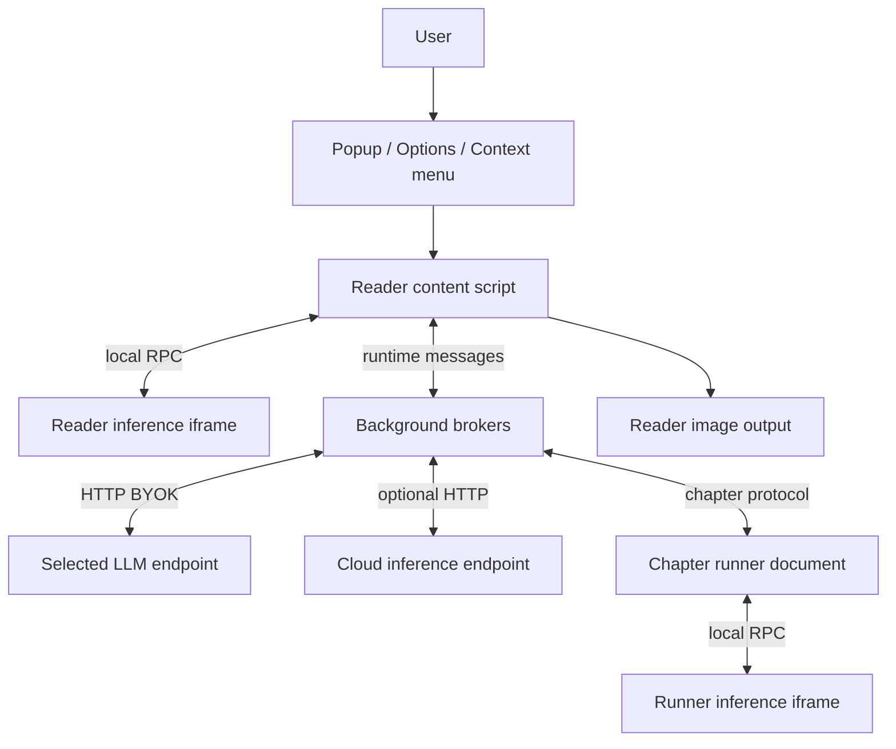

# Architecture

[English](../architecture.md) | ภาษาไทย

> แปลจากฉบับอังกฤษ: 2026-10-15 · โค้ดอ้างอิง: `09dfec1`

[สารบัญ](README.md) · [ถัดไป: Translation pipeline](translation-pipeline.md)

## 1. ภาพรวม

Arn Manga เป็น browser extension แบบ Manifest V3 ที่อ่านภาพมังงะ ตรวจหาข้อความ
ส่งข้อมูลให้ LLM ที่ผู้ใช้เลือก แล้ววาดคำแปลกลับลงภาพเดิม
local pipeline ไม่ต้องมี backend ของผู้พัฒนา แต่ยังเรียก LLM endpoint แบบ BYOK
และอาจต้องดาวน์โหลดโมเดลเมื่อใช้ครั้งแรก

เลือกได้สองส่วนแยกกัน:

- **Inference อยู่ที่ไหน**: `local` รัน detection/OCR/AI cleanup ในเครื่อง หรือ `cloud` ส่งไป endpoint ที่ผู้ใช้กำหนด
- **LLM อ่านอะไร**: `page` ส่งหน้า annotated พร้อม crops, `crops` ส่งเฉพาะ crops,
  `ocr` ส่งข้อความที่อ่านแล้ว; อาจมี VLM อีกตัวทำหน้าที่ถอดข้อความก่อนแปล

## 2. แผนภาพองค์ประกอบ

inference document ใน reader กับใน runner ใช้ source เดียวกัน แต่รันคนละ instance
model files อยู่ใน IndexedDB ร่วมของ extension แต่ session, queue และหน่วยความจำ inference
เป็นของ document นั้น ๆ ไม่ได้มี GPU mutex เดียวครอบทั้ง browser

queue/renderer อยู่ใน content หรือ runner ตาม workflow ส่วน cache/artifact stores
ดู [Data และ settings](data-and-settings.md)

## 3. Execution contexts

| Context | DOM | Extension APIs / storage | งานหลัก |
| --- | --- | --- | --- |
| Reader content script | DOM ของ reader | API ที่ content ใช้ได้; IDB ของ reader ไม่ใช่ extension store | หา/อ่านภาพ queue, Auto, แนบผล และ status UI |
| Chromium background | ไม่มี `document` | runtime, storage, tabs และ API ที่ประกาศสิทธิ์ | LLM HTTP, proxy, cache/chapter broker |
| Firefox background event page | มี DOM | extension APIs | broker เช่นเดียวกับ Chromium และเป็น parent ของ runner iframe |
| Chromium offscreen document | มี DOM | มี `chrome.runtime`; storage ผ่าน shim | chapter runner |
| Firefox runner iframe | มี DOM | extension context แยก frame จาก broker | chapter runner ชุดเดียวกับ Chromium |
| Inference iframe | มี DOM บน extension origin | runtime handshake และ extension-origin IDB | ORT, OCR, model sessions |
| Options / popup | มี DOM | extension settings และ IDB ที่เกี่ยวข้อง | แก้ settings, ดาวน์โหลดโมเดล, สั่งงาน, อ่าน diagnostics |

background bundle ใช้ร่วมกันทั้งสอง browser จึงห้าม import โมดูลที่แตะ DOM
เพราะ Chromium รันใน service worker การ render และ chapter orchestration จึงอยู่ใน document แยก

### ทำไม runner ของ Firefox ต้องเป็น iframe

broker กับ runner คุยผ่าน `runtime.sendMessage` แต่ Firefox ไม่ส่งข้อความกลับมายัง frame ผู้ส่งเอง
จึงวาง runner ใน hidden iframe ของ background event page แทนการเรียก pipeline ใน frame ของ broker
Chromium ใช้ offscreen document ด้วย reasons `WORKERS` และ `BLOBS`

runner ทำงานต่อได้เมื่อ reader reload หรือเปลี่ยนหน้า แต่ broker จะหยุดงานเมื่อปิดแท็บเจ้าของ
การปิด browser หรือ extension ก็ทำให้งานหยุดได้

## 4. การแบ่งความรับผิดชอบ

| พื้นที่ | ขอบเขต | จุดเริ่มอ่าน |
| --- | --- | --- |
| Content boot | guard การ inject ซ้ำ ติดตั้ง listeners โหลด settings/theme/font | [content.ts](../../src/content/content.ts) |
| Reader I/O | `PageRef`, discovery ของภาพ อ่านต้นฉบับ เขียนภาพกลับ | [page-io.ts](../../src/content/page-io.ts) |
| Page orchestration | prepare/cache/detect/order, queue และ render หนึ่งหน้า | [pipeline.ts](../../src/content/pipeline.ts), [queue.ts](../../src/content/queue.ts), [render-page.ts](../../src/content/render-page.ts) |
| Shared reader state | page registry, context/book, settings, theme, usage | [state.ts](../../src/content/state.ts) |
| Local inference | authenticated iframe RPC และ implementation โมเดล | [detection.ts](../../src/content/detection.ts), [worker.ts](../../src/iframe/worker.ts) |
| LLM logic | prompt/parser/book แบบ pure กับ HTTP adapters | [core.ts](../../src/llm/core.ts), [adapters.ts](../../src/llm/adapters.ts) |
| Background | เรียก LLM, retries/dedup, privileged fetch/storage | [background.ts](../../src/background/background.ts) |
| Chapter | enumerate ใน reader, broker, scheduler และ artifact store | [sweep.ts](../../src/content/sweep.ts), [chapter-broker.ts](../../src/background/chapter-broker.ts), [page.ts](../../src/chapter/page.ts) |
| Cache | policy, image verification, transactions, wire codec | [src/cache](../../src/cache) |
| Geometry/render | physical surface, ownership, erase mask และ text fitting | [balloon-surface.ts](../../src/content/balloon-surface.ts), [render.ts](../../src/content/render.ts), [inpaint.ts](../../src/content/inpaint.ts) |
| Configuration UI | draft/save/discard, model selection, fonts และ character edits | [src/options](../../src/options), [popup.ts](../../src/popup/popup.ts) |
| Optional server | CTD/Baberu/cleanup API ไม่ได้ถือ LLM key เพื่อแปลให้ | [app.py](../../server/app.py), [serve.py](../../server/serve.py) |

`content/page-cache.ts` re-export cache APIs และมี helpers สำหรับ reader, scheduling และ seam

## 5. ช่องทางสื่อสารและรูปแบบข้อมูล

| ช่องทาง | ใช้กับ | ข้อควรระวัง |
| --- | --- | --- |
| `tabs.sendMessage` | popup/background → content script | ผูกกับแท็บ/frame/document; หน้าเก่าอาจหายแล้ว |
| `runtime.sendMessage` | content/runner ↔ broker, storage proxy และคำสั่งระยะสั้น | ต้องมี deadline ใน call ที่บล็อกงาน และตอบ async ตาม API contract |
| `runtime.connect`, port `mt-rpc` | translate request และ interim OCR transcript | disconnect ไม่เท่ากับ provider หยุดคิด/ยกเลิก billing |
| port `mt-keepalive` | งานที่กำลังทำส่ง ping ทุก 15 วินาที | ลดการหลับระหว่างงาน ไม่ใช่หลักประกันว่า browser จะไม่ฆ่า process |
| `window.postMessage` | caller ↔ inference iframe | token auth, source/origin guard ฝั่ง client, transfer list สำหรับ bytes |
| HTTP | model downloads, LLM, Cloud และ reader image fetch | ต้องแยก retry policy และ credentials ตามประเภท request |

Chromium runtime messaging ใช้ JSON serialization จึงห่อ PNG/mask/font bytes เป็น base64
แต่ iframe postMessage ใช้ transferable `ArrayBuffer` ได้ อย่าย้าย binary object ข้ามช่องทางโดยคิดว่า codec เหมือนกัน
Firefox worker replies ถูก materialize ด้วย `structuredClone` ที่ boundary เพื่อลดปัญหา realm/Xray wrappers

ดูชนิดข้อมูลหลัก: `Prep`, `DetectResult`, `CachedPage`, `ContextState`, `ChapterProgress`, `ChapterArtifact`
ในไฟล์เจ้าของแต่ละระบบ ลำดับ region ที่ prompt/parser/render ใช้อ้างอิงเป็น **1-based**
ขณะที่ `ChapterPage.order` เป็น **0-based**

## 6. ข้อกำหนดร่วม

- Re-translate อ่านต้นฉบับ ไม่ใช้ภาพแปลที่วาดไว้ก่อนหน้า
- ตรวจ image identity ก่อน reuse state เพราะ reader อาจ recycle element หรือเปลี่ยน URL/encoding
- ปฏิเสธผล async ที่หมดสิทธิ์ด้วย guards ของ run, page, cache และ iframe ตามกรณี
- full cache เก็บ outputs, geometry และ patches ส่วน chapter artifact เก็บ rendered Blob ด้วย
- รักษาต้นฉบับของ regions ที่เป็น `keep`, ไม่มีคำตอบ หรือวางคำแปลไม่ปลอดภัย
- หยุดงานร่วมเมื่อเกิด auth/429 หรือ GPU ไม่ตอบทั้ง browser
- Cloud detection ล้มเหลวต้องแจ้ง error ไม่เปลี่ยนไป local และ local ไม่อัปโหลดไป Cloud เป็น fallback
- pill แสดงข้อมูลจาก activity registry การปิด popup ไม่หยุดงาน chapter

## 7. Build boundary

[build.mjs](../../build.mjs) สร้าง content เป็น IIFE/classic script ส่วน background, inference และ chapter entry เป็น ESM
ORT JavaScript/WASM ถูก copy เป็นไฟล์ runtime ไม่ bundle ผ่าน esbuild
เพราะ runtime loader/Emscripten มีข้อกำหนดของตัวเอง ส่วน Tesseract engine/worker ถูกแพ็กไว้ใน extension
ไม่โหลด remote executable script ตอนใช้งาน

manifest มีต้นฉบับเดียว [src/manifest.json](../../src/manifest.json)
build Firefox เปลี่ยน background เป็น event-page scripts และเพิ่ม Gecko/Android metadata
รายละเอียด build/release อยู่ใน [Development](development.md)

## 8. แหล่งอ้างอิง platform

- [Chrome Offscreen API](https://developer.chrome.com/docs/extensions/reference/api/offscreen): DOM, runtime-only extension API และ lifetime ตาม reason
- [Chrome message passing](https://developer.chrome.com/docs/extensions/develop/concepts/messaging): JSON serialization และ port lifecycle
