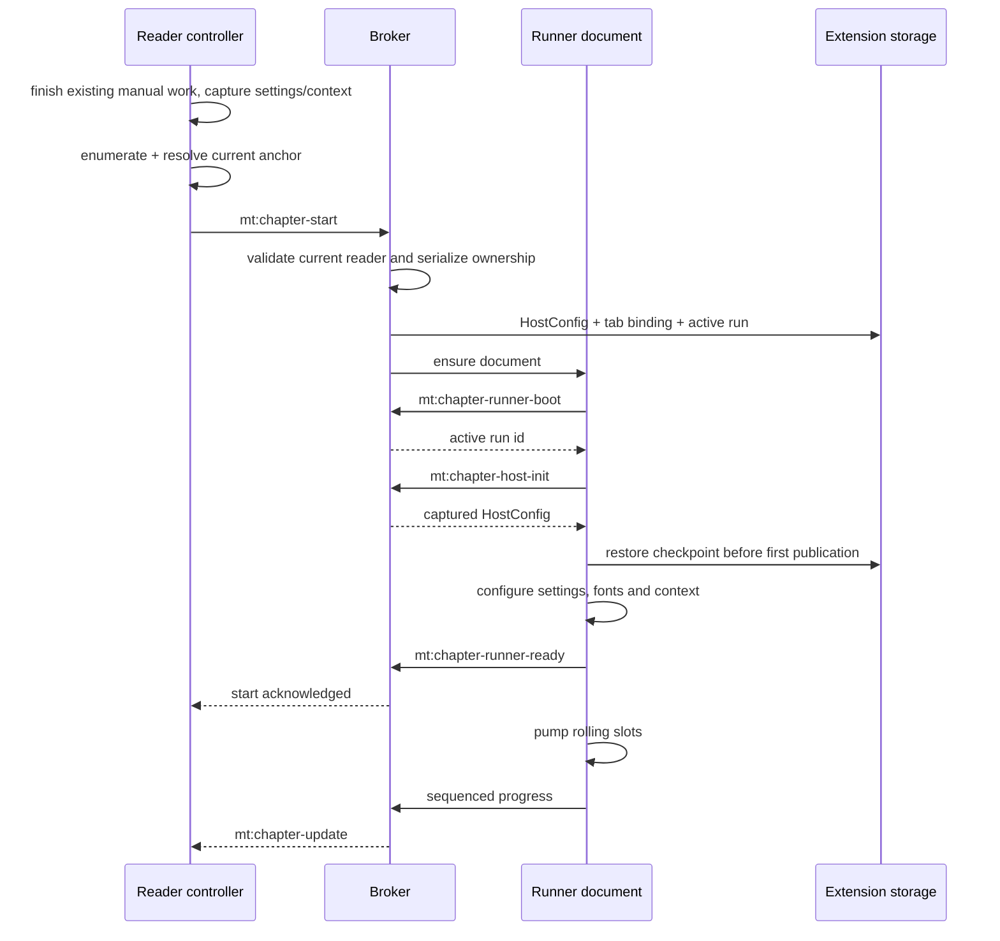
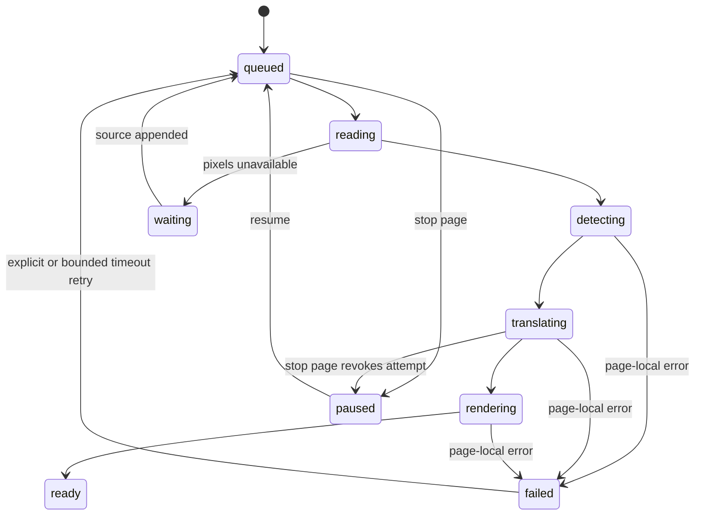

# Chapter translation

[English](../chapter-translation.md) | ภาษาไทย

> แปลจากฉบับอังกฤษ: 2026-10-15 · โค้ดอ้างอิง: `09dfec1`

[สารบัญ](README.md) · [ก่อนหน้า: Reader integration](reader-integration.md) · [ถัดไป: Inference](inference.md)

## 1. องค์ประกอบ

งาน chapter รันนอก reader document เพื่อให้ทำต่อได้เมื่อ reader reload หรือเปลี่ยนหน้า
reader ค้นหาหน้าและแสดงผล ส่วน broker จัดการ session และ runner ประมวลผล

| ส่วน | หน้าที่ | Source |
| --- | --- | --- |
| Reader controller | enumerate, หา current anchor, start/control, จับคู่ผลกับ DOM | [sweep.ts](../../src/content/sweep.ts) |
| Background broker | ตรวจเจ้าของ session, serialize lifecycle, runner boot, relay status/result | [chapter-broker.ts](../../src/background/chapter-broker.ts) |
| Runner adapter | เลือก Chromium offscreen หรือ Firefox hidden iframe | [runner.ts](../../src/chapter/runner.ts) |
| Runner pipeline | prepare, group, translate, render, save และ publish | [page.ts](../../src/chapter/page.ts) |
| Model / protocol | page list, progress, HostConfig, artifact และ signature | [model.ts](../../src/chapter/model.ts), [protocol.ts](../../src/chapter/protocol.ts) |
| Scheduling / lease | เลือกกลุ่มและ revoke attempt ที่หมดเวลา | [plan.ts](../../src/chapter/plan.ts), [lifecycle.ts](../../src/chapter/lifecycle.ts) |
| Persistent stores | artifacts/checkpoints และ debug log แยกฐานกัน | [store.ts](../../src/chapter/store.ts), [log-store.ts](../../src/chapter/log-store.ts) |

ชื่อ `sweep` ยังอยู่ใน symbol/message ภายใน แต่ user-facing feature คือ Translate to chapter end

## 2. Start protocol

scheduler รอ configuration เสร็จก่อนเริ่มงาน priority hint ที่มาระหว่าง setup
ต้องไม่ทำให้ detect ด้วย defaults แทน settings ของผู้ใช้
broker รอ ready acknowledgement และสร้าง context ใหม่ได้หนึ่งครั้งหาก attach ไม่สำเร็จ

### Scope ของการเริ่ม

- Start ใหม่เริ่มจากหน้าปัจจุบันไปข้างหน้า ไม่เริ่มจากหน้าแรกเสมอ
- ถ้าจับ current anchor ไม่ได้ ให้บอกเหตุผล ไม่เดาว่าเริ่มจากหน้า 0
- Resume เดินงานที่เหลือของ run เดิม ไม่คำนวณ start anchor ใหม่ตามหน้าที่เพิ่งเลื่อนไป
- หน้าที่แปลเสร็จแล้วใน reader ส่งเป็น seeds เพื่อไม่ทำงานซ้ำ
- ภาพ opaque เช่น canvas/blob อาจต้อง capture bytes ไว้ก่อน document อ่านหาย

## 3. หนึ่ง active runner กับหลายแท็บ

มี chapter runner ที่ active ได้หนึ่งงานใน extension instance นี้
การเริ่มงานจากอีกแท็บจึง retire/pause session เก่าแล้วเปลี่ยนเจ้าของ ไม่ให้ทั้งสองแท็บแย่ง document เดียวกัน

broker เก็บ `mtChapterTab:<tab>` เป็น per-tab binding และ `mtChapterActive` เป็น active session
คำสั่ง/การ publish ต้องตรงกับ owner ปัจจุบัน มี run id อย่างเดียวไม่พอ
start/close/clear ใช้ lifecycle chain เดียวกันเพื่อลด race

การ reload reader ไม่ได้สั่งปิด runner ทันที แต่การปิด **แท็บเจ้าของปัจจุบัน** มี cleanup policy ให้หยุด runner
การปิดแท็บเก่าที่ถูกแทนเจ้าของไปแล้วต้องไม่ไปฆ่า run ของแท็บใหม่
checkpoint/artifact ช่วย recovery แต่ไม่ได้สัญญาว่าทำงานต่อเองหลัง browser restart โดยไม่มี user intent

## 4. Rolling slots และการรวมหน้า

- `parallelLlm`: จำนวน **ชุดงาน/slots** ที่ทำพร้อมกัน; runner จำกัด 1–6
- `mergePages`: จำนวน **หน้าต่อชุด** ที่พยายามรวมเป็น translation request; จำกัด 1–10

ตัวอย่าง `parallelLlm=2`, `mergePages=3`: อาจมีสองชุด ชุดละสามหน้าอยู่ระหว่าง prepare/translate/render
เมื่อชุดหนึ่งเสร็จ slot นั้นเริ่มชุดถัดไปทันที ไม่รอให้ทุกชุดใน wave เสร็จพร้อมกัน
ตัวเลขนี้ไม่ใช่เพดาน global ของ HTTP calls ทุกชนิด เพราะ fallback/per-region reader อาจมีโครงสร้างคำขอเพิ่ม

### ขั้นตอนหนึ่ง slot

1. เลือกกลุ่ม queued pages ตาม page order/priority และ claim phase แบบ synchronous
2. ขอ context snapshot ก่อนหน้าลำดับแรกของกลุ่ม ณ เวลา slot เริ่ม
3. Prepare ภาพแต่ละหน้า: artifact reuse → source → hash → full cache/checkpoint → detect/order
4. หน้าที่มีคำแปล cached แล้ว render/commit ได้ทันที ไม่ต้องรอ LLM ของเพื่อนร่วมชุด
5. หน้าที่ต้องแปลใหม่เรียงกลับตาม page order ก่อน combine
6. รวม pixels เป็น working bitmap พร้อมเลื่อน boxes/clip/balloon geometry ตาม offset
7. เรียก `translateRegions` ครั้งเดียวสำหรับกลุ่ม แล้วแยก outputs กลับด้วย box offsets
8. Render/save แต่ละหน้า จากนั้นเพิ่ม context contribution และ publish ready revision

Page mode ยังคงส่ง **annotated full page ต่อหน้า** นำหน้าชุด crops
ไม่ส่งภาพยาวที่ stitch เป็นหน้าเดียวให้ใช้เป็น full-page context โดยไม่แบ่ง segment
badges เป็น global IDs ของกลุ่ม แต่ chunk retries มี request-local region IDs ที่ map กลับได้

Extras ถูกปิดใน merged request เพราะไม่มี page attribution ที่ปลอดภัยสำหรับพิกัดเสริม
ส่วน `<names>` มี block เดียว จึงนำ mentions ไป fold กับหน้าสุดท้ายของกลุ่ม

### Trade-off ของ parallel context

slot ที่เริ่มพร้อมกันไม่เห็นคำตอบที่อีก slot ยังไม่ส่งกลับมา
เมื่อ slot ใหม่เริ่มจึงเห็น contributions ก่อนหน้าที่ commit แล้ว
เพิ่ม concurrency จึงลดเวลารอได้ในบาง workload แต่ไม่เท่ากับ sequential narrative context
การรวมหลายหน้าใน request ช่วยให้โมเดลเห็นเนื้อหาภายในกลุ่มร่วมกัน แต่เพิ่ม payload และ decoded-image residency

## 5. Progress เป็น state machine

นี่เป็นภาพย่อของ per-page phases; cache/artifact/no-text อาจข้ามหลายขั้นไป `ready`
run เองมี `running`, `waiting`, `stopping`, `stopped`, `complete`, `error`
`complete` บอกว่าเดินรายการที่รู้จบแล้ว ไม่ได้แปลว่า errors เป็นศูนย์
`waiting` อาจหมายถึง discovery ยังไม่ครบหรือ pixels ยังต้องรอ reader

`publish` คำนวณ done/errors/inflight จาก page states และเพิ่ม monotonic `sequence`
checkpoint ต้องรักษา sequence เมื่อ restore และ consumer ต้องไม่ให้ poll เก่าทับ push ใหม่หรือ Stop ของผู้ใช้
progress update ไม่ควรทำให้ reader echo priority แล้ว runner publish วนเป็น feedback loop

## 6. Stop, lease และ retry

Stop เพิ่ม run epoch, cancel attempts และ disconnect live translation RPCs
late result ของ epoch/page attempt เก่าไม่มีสิทธิ์ commit แม้ promise ภายในจะเพิ่ง resolve
ขณะ drain อาจมี phase `stopping` ก่อนเป็น `stopped`

`Attempt` ครอบงานช้าด้วย lease แยกจาก inference RPC/HTTP deadline
timeout ของหน้าเดียวต้องคืน slot ไม่ค้างทั้งบท; lease กลุ่มหมดอายุหรือ group combine/translation ล้มเหลว
สามารถ fallback ไป per-page attempts ได้ โดยแต่ละหน้ามี lease ของตัวเอง

| Failure | การจัดการ |
| --- | --- |
| Source ยังไม่มี pixels | page `waiting` และรอ append/capture |
| Error เฉพาะหน้า | mark failed แล้วเดินหน้าอื่นต่อ |
| Timeout-class page failure | มี end-of-walk automatic retry ได้หนึ่งครั้งต่อ page id ต่อ active runner session |
| Auth / 429 | เมื่อ page error handler รับ failure จะ pause shared work; adapter กัน request 429 ซ้ำระหว่าง refusal window |
| ยืนยันว่า GPU ไม่ตอบทั้ง browser | shared inference halt; ไม่ใช้สิทธิ์ retry ทุกหน้าซ้ำ |
| Persist/publish ไม่สำเร็จ | แจ้ง fatal/progress error ไม่ปล่อย UI เหมือนงานยังเดินปกติ |

Stop ป้องกัน late commit และการส่งคำขอเพิ่ม แต่ provider อาจทำคำขอที่รับไปแล้วต่อจนเสร็จ
cache/checkpoint ที่บันทึกก่อนหยุดอาจยังอยู่

## 7. Artifact, translation cache และการแนบกลับ

[ChapterArtifact](../../src/chapter/protocol.ts) มี rendered Blob, entry, image identity, source hash และ signature
บันทึกใน `mt-chapter` แยกจาก full translation cache `mt-cache`
artifact key คือ `result:<run-id>:<page-id>` ส่วน checkpoint/config/status เป็น record คนละ key

Reader รับ ready progress แล้ว:

1. Resolve ว่า element ที่มองเห็นตรงกับ chapter page ใด ด้วย URL/manifest/verified pixels
2. ขอ evidence หรือ artifact ผ่าน broker ที่ผูกกับ tab/chapter นั้น
3. ตรวจ run/page revision, image identity และ signature ตาม [attach-policy.ts](../../src/content/attach-policy.ts)
4. หากต้องปรับ rendition/render ใช้ entry ที่ยืนยันแล้ว ไม่ reuse cleanup crop ของ pixels อื่น
5. สร้าง reader `PageState` และเขียนผ่าน `writePage`

ภายใน active run ready revision มี authority ของตัวเองตาม attach policy
เมื่อ run จบจึงกลับไปใช้ compatibility กับ current settings ตามปกติ

## 8. Settings และ debug

runner ใช้ pipeline snapshot ที่จับตอน start; การเปลี่ยน translation/model settings ที่ broker จับได้ทำให้ pause/stale
ต้องเริ่ม chapter ใหม่เพื่อใช้ settings ใหม่ ไม่ Resume run เก่าที่ stale
`prefetchN`, `cacheMax`, `showToasts` เป็นข้อยกเว้นที่ไม่ทำให้ pause
popup Context toggle ส่งเป็นคำสั่งเฉพาะ และมีผลกับชุดถัดไป ไม่เปลี่ยน snapshot ของคำขอที่ออกไปแล้ว

local inference host ถูก retain ตลอด active pump เพื่อไม่ unload โมเดลระหว่างรอ LLM นาน
แต่ retain ไม่สร้าง iframe เอง จึงไม่บูต ORT ใน Cloud/cache-only path โดยไม่จำเป็น

เมื่อเปิด Debug จึงบันทึก structured chapter logs; popup อ่าน `mt-chapter-logs` โดยตรง
แม้ runner ไม่ตอบก็ยังเปิด log ที่บันทึกไว้ได้ รายละเอียด schema/retention อยู่ใน [Data](data-and-settings.md)

## 9. Tests

- [chapter-startup](../../tests/chapter-startup.test.mjs): configure-before-pump และ restore ordering
- [chapter-broker-state](../../tests/chapter-broker-state.test.mjs): session ownership และ tab handoff
- [chapter-merge-order](../../tests/chapter-merge-order.test.mjs), [chapter-order](../../tests/chapter-order.test.mjs): grouping/output order
- [chapter-auto-retry](../../tests/chapter-auto-retry.test.mjs), [chapter-watchdog](../../tests/chapter-watchdog.test.mjs): bounded recovery
- [attach-policy](../../tests/attach-policy.test.mjs), [state-sync](../../tests/state-sync.test.mjs): attach authority และ stale async publications
