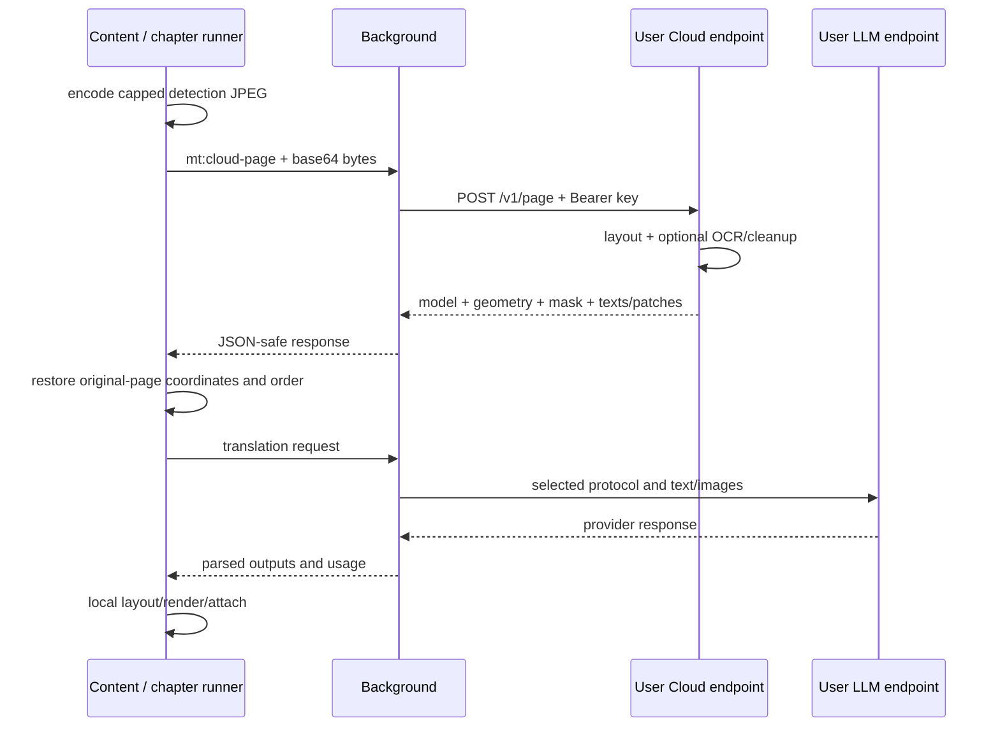

# Cloud inference และ security boundaries

[English](../cloud-and-security.md) | ภาษาไทย

> แปลจากฉบับอังกฤษ: 2026-10-15 · โค้ดอ้างอิง: `09dfec1`

[สารบัญ](README.md) · [ก่อนหน้า: Data และ settings](data-and-settings.md) · [ถัดไป: Development](development.md)

## 1. หน้าที่ของ server

optional server ใช้ KoharuLayout detection เป็นค่าเริ่มต้น (หรือ CTD ที่เลือกไว้), Baberu OCR และ Manga-LaMa cleanup
ไม่รับผิดชอบ character book, translation LLM, text fitting หรือการเขียนภาพกลับ DOM
KoharuLayout ใช้ได้ทั้ง local และ Cloud โดยใช้ model export เดียวกัน
local mode ไม่ต้องมี server นี้และไม่มี silent upload fallback ไป Cloud

Cloud-only/cache-only startup ไม่สร้าง local ORT iframe
ส่วน decoding, verification, crop/encode และ rendering ยังทำใน browser

## 2. Server modules และ environment

| Source | Responsibility |
| --- | --- |
| [app.py](../../server/app.py) | FastAPI endpoints, model loading, CTD/OCR/cleanup recipes และ inference lock |
| [koharu.py](../../server/koharu.py) | ตรวจ FP32 artifact, preprocessing และ instance decoding ที่ตรงกับ worker |
| [split.py](../../server/split.py) | detection split/crop/mask helpers และ split generation |
| [balloon_surface.py](../../server/balloon_surface.py) | physical text-surface refinement ก่อน OCR |
| [models_manifest.py](../../server/models_manifest.py) | model source metadata ที่ setup scripts ใช้ |
| [serve.py](../../server/serve.py) | standalone launcher และ optional Bearer middleware |
| [modal_app.py](../../server/modal_app.py) | deployment image/providers, proxy auth และเพดาน GPU containers ของ Modal |
| [Dockerfile](../../server/Dockerfile) | CPU image; bake weights เข้า image |

`MODEL_DIR` default `/models`; standalone ใช้ `ORT_PROVIDERS=CPUExecutionProvider` ถ้าไม่ override
Modal source กำหนด CUDA→CPU provider chain, Python 3.12, CUDA runtime image และ pin `onnxruntime-gpu==1.30.0`
ตรวจ providers ที่ใช้งานจาก `/health` หรือ logs

`server/requirements.txt` และ Docker pip dependencies ส่วนใหญ่ไม่ pin version
generated notebooks มาจาก [make-colab.py](../../scripts/make-colab.py) ไม่แก้ `.ipynb` ตรง
วิธี setup อยู่ใน [server/README.md](../../server/README.md); quota/pricing ของ hosting เปลี่ยนได้ ต้องตรวจผู้ให้บริการก่อน deploy

## 3. HTTP contracts

### `GET /health`

ตอบ `ok`, `device`, `layoutModel`, `layoutModels`, `layoutRecipe`, `modelSha256`, `panels`, `ep`, `splitGen`
`ok` สะท้อน Koharu/Baberu loaded และไม่ได้รับประกันว่า optional cleanup model พร้อม
`panels` ระบุ panel inference ของ Koharu
Modal ตรวจ auth ที่ proxy ทุก path รวม root/health ก่อนถึง GPU ส่วน standalone/Colab
ยังเปิด health เป็น public จึงไม่พิสูจน์ว่า key ถูกต้อง ส่วนขยายส่ง Bearer key ทั้ง Test และ chapter warm

### `POST /v1/page`

- Body: raw image bytes; extension ส่ง `Content-Type: image/jpeg`
- Query: `layout_model=koharu` (default) หรือ `ctd`, `min_size`, ค่า Koharu `text_conf`/`sfx_conf`/`bubble_conf`/`panel_conf`, ค่า CTD `conf_thr`, optional `texts=0`, `inpaint=1`, `pad_ratio`
- Reply: model identity, `ok`, `w`, `h`, boxes/clip/cutAxis, panels, balloon shapes, `texts`, packed mask, split generation, timings และ optional indexed PNG patches
- `texts[i]` ตรงกับ `boxes[i]` ในลำดับก่อน client reorder
- `texts=0` ข้าม Baberu เมื่อ translation LLM อ่านภาพเอง
- `inpaint=1` ลองรวม cleanup ใน round trip เดียว; cleanup failure อาจได้ patches ว่างโดย detection ยังสำเร็จ
- Koharu ส่ง panels ให้ client จัดลำดับ; CTD และ tiled strips ใช้ text-position banding โดยไม่โหลด local YOLO
- Koharu recipe/hash ต้องตรงกับ extension; server เก่าหรือโมเดลไม่ตรงจะแจ้ง error ไม่บันทึกผล CTD ลง Koharu cache

### `POST /v1/inpaint`

Body เป็น JSON: `image` base64 image, `boxes`, optional `mask` base64 grayscale PNG
mask ที่ส่งต้องขนาดเท่าภาพ; mismatch เป็น 400 และไม่มี cleanup model เป็น 503
reply เป็น patches ที่มีพิกัด PNG bytes (base64), window count และ timings
ใช้เมื่อ precomputed detect patches ใช้ไม่ได้ เช่น keep-overlap หรือ coverage ไม่ครบ

server ใช้ shared asyncio lock ป้องกัน inference requests แย่งโมเดลภายใน process
ไม่ใช่ global distributed queue ของหลาย replicas

## 4. Coordinate spaces

`cloudDetect` จำกัดด้านยาวของ **detection upload** ที่ 1600 px
พร้อม scale factor `originalLongSide / uploadedLongSide`
server ตอบใน uploaded image space แล้ว client map boxes, panels, clips และ patch rectangles กลับ original page
patch PNG ที่ยังขนาด upload ถูก draw scaling ให้ตรง rectangle ปลายทาง
balloon row spans เก็บ source dimensions เพื่อ lookup แบบ proportional และไม่ใช้เป็น erase mask

mask ใช้ packed codec แล้ว unpack กลับ original dimensions
response รุ่นเก่าที่ไม่มี mask มี compatibility fallback แต่การ reuse ยังต้องผ่าน minimum split generation ของ client

`/v1/inpaint` ส่ง page JPEG และ prepared erase mask ใน resolution เดียวกัน
โดยไม่มี cap 1600 px แบบ detection หากย่อภาพต้อง scale ภาพ mask และ boxes ไปด้วยกัน

## 5. Deadlines และ error semantics

| Operation | Background request cap | Caller wait |
| --- | --- | --- |
| Cloud health Test | 120s | ตามเส้นทาง options test |
| Chapter warm | 180s | 190s |
| Cloud detect | 90s; 150s เมื่อขอ inpaint | 160s |
| Dedicated cleanup | 90s | 100s |

caller timeout อยู่เหนือ HTTP cap เพื่อเผื่อ message/encoding/response overhead
แต่อาจหมดเวลาเพราะ background ไม่รับคำขอ ไม่ได้แปลว่า server ช้าเสมอ
chapter logs แยก sent→received→HTTP start→HTTP reply→response เพื่อช่วยจำแนก

Cloud detection ล้มเหลวเป็น `kind:'cloud'` ไม่ fallback local
แต่ cleanup ล้มเหลวสามารถใช้ built-in fill เพื่อ render ต่อได้

## 6. Auth และ deployment exposure

- `serve.py` เปิด Bearer middleware เมื่อ `ARN_API_KEY` มีค่า ถ้าไม่ตั้งจะเตือนและไม่มี auth
- `uvicorn app:app` โดยตรงไม่ได้เปิด middleware ของ `serve.py` แม้ export env key ไว้
- Modal ใช้ `asgi_app(requires_proxy_auth=True)` ปฏิเสธ Proxy Token ที่หายไปหรือไม่ถูกต้องก่อนถึง GPU รวม root/health โดยไม่ใช้ `ARN_API_KEY` ภายใน container
- ใส่ Proxy Token แบบรวม `wk-….ws-…` ในช่อง API key เดิม ไม่ต้องใส่คำว่า `Bearer ` และไม่ใช่ credentials `ak-`/`as-` สำหรับ deploy ทุก Cloud operation ส่ง key นี้ผ่าน Authorization Bearer เหมือนกัน
- notebook สร้าง token และถ้าเปิด RBAC จะอนุญาต deployment environment ให้อัตโนมัติ ส่วน workspace ที่ไม่มี RBAC token เป็นแบบ workspace-wide และ `allow` จะตอบ `Token is not environment-scoped` จึงไม่ต้องทำอะไรเพิ่ม token ไม่ได้จำกัดเฉพาะ app นี้: ใช้กับ protected apps อื่นใน workspace ได้ หรือเฉพาะ allowed environments เมื่อเปิด RBAC modal แสดง secret ของ token เพียงครั้งเดียว ต้องเก็บเป็นความลับและลบ token ที่ไม่ใช้
- Dockerfile ปัจจุบันเริ่ม `uvicorn app:app` โดยตรง ต้องมี auth/reverse-proxy layer ก่อนเปิดให้เข้าถึงสาธารณะ
- public health ของ standalone สำเร็จไม่ได้พิสูจน์ว่า API key ถูกต้อง ต้องมี authenticated request path ที่เกี่ยวข้องด้วย

deployment Modal เดิมต้อง redeploy server และเปลี่ยน random key เดิมในส่วนขยายเป็น Proxy Token
อัปเดตส่วนขยายอย่างเดียวไม่ป้องกัน URL ที่ deploy ไว้แล้ว ส่วน secret `arn-manga-key` เดิมไม่ใช้งานหลังย้าย
รัน notebook ใหม่จะสร้าง Proxy Token ใหม่ แต่ Proxy Tokens ก่อนหน้ายังใช้ได้จนกว่าจะลบใน
Modal Settings → Proxy Auth Tokens หรือ `modal workspace proxy-tokens delete`
การ Stop/redeploy app ไม่ได้เพิกถอน credentials ระดับ workspace เหล่านี้

**health บน GPU endpoint ไม่ใช่ liveness probe ฟรี** การ Test/prewarm ด้วย key ที่ถูกต้อง
รวม authenticated checks ใน notebook สามารถปลุก GPU และโหลดโมเดลแม้ไม่ได้แปลหน้าใด
ทรัพยากรที่จองไว้ระหว่าง warm idle ก็คิดค่าใช้จ่าย deployment ตั้ง `min_containers=0`,
`max_containers=1`, `scaledown_window=90` ซึ่งจำกัดจำนวน containers พร้อมกัน ไม่ใช่ยอดเงินสะสม
ถ้า valid token หลุดก็ยังเผา compute ได้ ต้องตรวจ quota/pricing ของบัญชีและไม่เพิ่ม public monitor ที่เรียก GPU app

อ้างอิง [Modal proxy authentication](https://modal.com/docs/guide/webhook-proxy-auth)
และ [idle/cold-start billing](https://modal.com/docs/guide/cold-start)

ใช้ HTTPS เมื่อผ่าน network ที่ไม่เชื่อถือ เพราะ HTTP ไม่เข้ารหัสข้อมูลระหว่างทาง
อย่าใส่คีย์จริงใน URL ตัวอย่าง shell history หรือ configuration ที่ commit

## 7. ข้อมูลออกจากเครื่องตาม workflow

| Destination | ข้อมูลที่เกี่ยวข้อง |
| --- | --- |
| Translation endpoint | images ตาม page/crops หรือ OCR texts, prompt, selected character/context data และ credential ของ endpoint |
| Separate VLM reader endpoint | ภาพสำหรับ transcription และ credential ของ reader; อาจเป็นผู้ให้บริการคนละรายกับ translator |
| Cloud inference endpoint | page pixels, detection parameters และอาจมี cleanup mask/boxes; ไม่ใช่เฉพาะ text crops |
| Public model/font mirrors | network requests เพื่อดาวน์โหลด assets; ไม่อัปโหลดหน้ามังงะเพื่อขอ weights |
| Reader image/API hosts | fetch source/manifest/API ตาม integration |

keys บันทึกใน `chrome.storage.local` และส่งให้ endpoint เพื่อ authenticate
ผู้ที่เข้าถึง browser profile อาจอ่านคีย์ได้ ส่วน retention, training และ billing ขึ้นอยู่กับ provider
ดู [Privacy policy](../../PRIVACY.md)

## 8. Trust boundaries ของ extension

### Inference iframe

web-accessible document ใช้ secret RPC token เพื่อกัน page scripts สั่ง download, delete หรือ compute
client ตรวจ source/origin และ frame generation แต่กลไกนี้ไม่ป้องกัน renderer ที่ถูกยึดแล้ว

### Image fetch proxy

privileged proxy ตรวจ `fetchImageBlocked` ทั้ง requested URL และ final `resp.url`
ก่อนส่ง bytes กลับ โดยจำกัด schemes และ private/loopback hosts ตาม requester policy
นี่เป็น URL/readback guard ไม่ใช่ DNS-aware firewall หรือคำรับรองว่าไม่มี request ไปถึง redirect target ก่อนตรวจ response
Cloud/LLM custom endpoints เป็น user-configured capability แยกจากภาพที่เว็บปลูกไว้ใน DOM

### Screenshot

ใช้ activeTab gesture และ active-sender/window check ไม่ capture แท็บอื่นเพราะงานของ background tab
ภาพที่ capture มีข้อมูลบนจอ จึงต้อง crop ตาม page region และไม่เรียกเป็น background collection loop

### Storage / chapter messages

cache payloads scope ตาม reader chapter; runner publish/control ต้องตรง active owner
Chromium runner ไม่มี sender tab และใช้ extension-document identity
Firefox ใช้ non-tab extension-context check ที่กว้างกว่าการตรวจ URL ของ Chromium

## 9. Limits และการตรวจความปลอดภัย

structured chapter log ใช้ whitelist ที่ไม่มี raw image/text/key/URL fields
แต่ debug console, prompts, timing reports และ error strings ไม่ได้มี privacy guarantee เท่ากันทุกช่องทาง
ก่อนแชร์ logs ต้องตรวจ keys, endpoint query params, source text และ reader identifiers ด้วย

host permissions/CSP ไม่แทน input validation หรือขีดจำกัด memory/request size
public deployment ต้องมี abuse controls, TLS, authentication และ resource limits

tests: [cloud](../../tests/cloud.test.mjs), [host-access](../../tests/host-access.test.mjs),
[worker-token](../../tests/worker-token.test.mjs), [worker-handshake](../../tests/worker-handshake.test.mjs),
[cache-transport](../../tests/cache-transport.test.mjs), [test_inpaint_mask.py](../../server/test_inpaint_mask.py)
