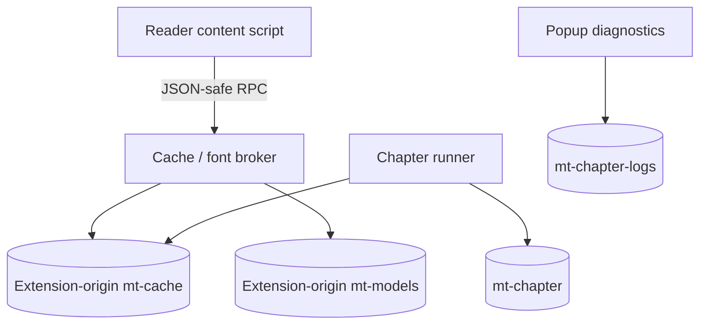

# Data, settings และ state synchronization

[English](../data-and-settings.md) | ภาษาไทย

> แปลจากฉบับอังกฤษ: 2026-10-15 · โค้ดอ้างอิง: `09dfec1`

[สารบัญ](README.md) · [ก่อนหน้า: Rendering](rendering.md) · [ถัดไป: Cloud และ security](cloud-and-security.md)

## 1. ที่เก็บข้อมูล

คำแปลใช้ storage ร่วมของ extension ส่วน credentials, models และ books มีอายุข้อมูลแยกกัน
จึงไม่ถูกลบเมื่อใช้ Clear translations

| ที่เก็บ | ตัวอย่างข้อมูล | Lifetime / access |
| --- | --- | --- |
| `chrome.storage.local` | `mtSettings`, `mtOcrSettings`, `mtPipeline`, `mtDebug`, `mtTheme`, Auto sites, `mtBook:*`, overrides, cache generation | persisted ใน browser profile; ไม่ใช่ server account |
| Session wrapper | `mtCtx:*`, `mtShare:*`, `mtChapterActive`, `mtChapterTab:*`, ledger, worker tokens | browser session เมื่อ API พร้อม; fallback เป็น context-local memory |
| IDB `mt-models`, store `m`, v1 | CTD/panel/cleanup, Koharu key, `baberu:*`, `tess:*`, `font:*` | extension-origin model/font bytes ใช้ร่วมกัน |
| IDB `mt-cache`, v2 | `pages` payloads และ `metadata` | full translations, aliases และ partial checkpoints |
| IDB `mt-chapter`, v1 | `records`: host/config/status/checkpoint/artifact/error | ผล/สถานะของ chapter execution |
| IDB `mt-chapter-logs`, v1 | `heads`, `events`, `pages` | Debug-only structured diagnostics มี bounded retention |
| Reader in-memory state | page registry, bitmap/Blob URLs, binding/index maps, queue | ตายเมื่อ document หาย และต้อง release owned resources |
| Background in-memory state | in-flight/recent LLM replies, learned provider capabilities, refusal windows | หายเมื่อ background context restart |
| Reader sessionStorage markers | warming/LLM progress timestamps | ช่วยบอก continuity ไม่ใช่แหล่งคำแปลหรือสิทธิ์เริ่มงาน |

## 2. Reader กับ extension-origin IndexedDB

content script อยู่กับ reader origin จึงไม่เปิด `indexedDB` แล้วหวังว่าจะได้ database ของ extension
cache/font bytes ต้องผ่าน broker ส่วน runner/options/inference documents อยู่ extension origin จึงใช้ store ร่วมได้
binary ใน runtime RPC ใช้ [wire.ts](../../src/cache/wire.ts) เพื่อไม่สูญหายเมื่อ Chromium JSON-serialize

broker scope cache get/put/delete ตาม browser-attested chapter ของ reader
[sender-url.ts](../../src/cache/sender-url.ts) เลือก live tab URL ก่อน injected `sender.url`
เพราะ SPA อาจเปลี่ยน chapter โดย document เดิมยังอยู่
global cache counts เป็น aggregate แต่ไม่ได้ให้ reader อ่าน payload ของบทอื่นได้

## 3. Translation identity มีสอง key

- `chapter#hash`: original decoded pixel rendition; detection/OCR checkpoint และ cleanup crops ผูกที่นี่
- `chapter@pN`: logical page slot; เป็น **candidate lookup** ไม่ใช่คำยืนยันว่าภาพปัจจุบันเป็นหน้านั้น

hash มาจาก 48×48 grayscale sample ด้วย cyrb53-style hash ไม่ใช่ SHA-256 ของ original file bytes
ดังนั้นคำว่า bytes key ในโค้ดหมายถึง pixel-rendition identity ในระบบนี้ ไม่ใช่ cryptographic byte equality

page-slot hit ต้องผ่าน recipe/complete-data gates และ image verification
ที่ใช้ page/region evidence ไม่ใช่ยอมรับเพียง dimensions/aspect ratio
verified proportional rendition scale boxes, clips, panels และ extras ไปด้วยกัน
cleanup crops ของ rendition อื่นต้องทิ้งและสร้างใหม่จาก original pixels ชุดปัจจุบัน

รายละเอียดอัลกอริทึม lookup/transactions อยู่ใน [Translation cache](../cache.md)

## 4. Full result กับ checkpoint

`CachedPage` อาจเป็น full result หรือ `partial: true`:

| สถานะ | ใช้ทำอะไร | ผู้ใช้เห็นว่าเสร็จหรือไม่ |
| --- | --- | --- |
| Detection checkpoint | reuse ordered boxes/mask หลังงานถัดไปล้มเหลว | ไม่ใช่ translated page |
| OCR checkpoint | reuse source texts เพิ่มจาก detection | ยังไม่ใช่คำแปล |
| Full result | outputs/extras/mentions + geometry/mask และ optional cleanup patches | ต้อง render/attach ก่อนอ่านใน reader |
| Chapter artifact | rendered Blob + entry + identity/signature/revision ที่เกี่ยวข้อง | attach ได้เมื่อ evidence ตรง |

`cacheEnabled` คุม full translation reuse/storage ไม่ปิด in-flight checkpoints
full cache off แล้วหน้าที่ทำสำเร็จต้องลบ checkpoint ที่จบหน้าที่ ไม่สะสมเป็นงานค้างถาวร
late partial entry ห้ามทับ full result ที่ recipe/dimensions เดียวกัน
partial ที่มี OCR แล้วไม่ควรถูก detection-only write ที่มาช้าล้าง texts ทิ้ง

## 5. Fingerprint และ generations

### Translation fingerprint

[settingsFingerprint](../../src/cache/policy.ts) ครอบ inputs/behavior ที่มีผลต่อข้อความ เช่น
target language, textSource/OCR, detector/order, prompts/context options,
image encoding/sizing, thinking/temperature และ `mergePages`
Koharu เพิ่ม recipe/hash/thresholds ของตัวเอง โดยรักษา CTD fingerprint compatibility ตาม implementation

การเปลี่ยน font/color/size, cleanup, concurrency, cache capacity และ provider/model
ยังใช้คำแปลที่ cache ไว้ได้ หากต้องการคำตอบใหม่จากโมเดลใหม่ให้ใช้ Re-translate
เนื้อหา book/context ที่เพิ่มขึ้นก็ไม่ทำให้ cache เก่าหมดอายุ

### Recipe versions ปัจจุบัน

| ตัวควบคุม | ค่าใน source baseline | ขอบเขต |
| --- | --- | --- |
| fingerprint recipe suffix | `tile40` | translation/detection/prompt recipe compatibility |
| `RENDER_GEN` | 47 | rendered artifact/layout compatibility |
| `CLOUD_SPLIT_GEN` / Python `SPLIT_GEN` | 18 / 18 | ความสดของ Cloud split/mask data |
| `INPAINT_PATCH_GEN` | 5 | cleanup crop recipe |
| `PAGE_KEY_GEN` | 1 | logical page-key evidence format |

นิยามอยู่ใน [cache/policy.ts](../../src/cache/policy.ts), [render.ts](../../src/content/render.ts)
และ [server/split.py](../../server/split.py) ส่วน model digest, image identity generation
และ `chapterSignature` ใช้ตรวจ compatibility แยกอีกชั้น

## 6. Retention, transaction และ Clear

store นับ capacity เป็น **logical completed pages** รวม slot/rendition aliases เข้ากลุ่ม
evict ทั้งกลุ่มแบบ LRU และมี checkpoint allowance แยก
payloads มี estimated byte allowance 256 MiB ไม่ใช่ total RAM budget ของ browser
metadata store ช่วย count/evict โดยไม่อ่านทุกภาพ payload เข้า memory

write batch ต้องถือว่าเสร็จที่ transaction completion ไม่ใช่แค่ `put` request success
read touch แก้ metadata ไม่เอา payload เก่าที่เพิ่งอ่านกลับไปทับ result ใหม่
storage write บาง path เป็น best effort แต่ transport error ตอนอ่านต้องแจ้ง error
ไม่ถือเป็น cache miss ที่ทำให้เรียก LLM ซ้ำ

Clear translations เป็น coordinated operation:

1. Persist `mtCacheGeneration` ใหม่และประกาศให้ producers ยอมรับ
2. หยุด active chapter lifecycle และล้าง artifacts/bindings ที่เกี่ยวข้อง
3. ล้าง shared translation cache
4. แจ้ง readers ให้ restore originals/release page state
5. งานเก่าที่กำลังรอตอบตรวจ generation ก่อนนำผลกลับมาใช้หรือบันทึก

การเปลี่ยน generation ยกเลิกสิทธิ์ของงานเก่า เพื่อไม่ให้คำตอบที่ยังรออยู่เขียนกลับหลัง Clear
models, credentials และ character books ยังอยู่

## 7. Settings schema, defaults และ drafts

[pipeline-settings.ts](../../src/llm/pipeline-settings.ts) เป็นเจ้าของ schema/defaults/presets/defensive loading
อย่าเขียน defaults ซ้ำใน UI, chapter host หรือ cache policy โดยไม่ใช้ policy กลาง

ค่าตั้งต้น:

| Setting | ค่า |
| --- | --- |
| inference / layout | `local` / `koharu` |
| Cloud layout default | `koharu` เมื่อยังไม่มี explicit choice |
| text source / local OCR engine | `crops` / `baberu` |
| target / reading direction | `Thai` / `rtl` |
| cleanup | `auto`: local fill, Cloud AI |
| context / characters / cross-chapter | เปิด |
| pairs / learned roster target | 15 / 10 |
| parallel sets / pages per set | 1 / 3 |
| pages ahead / full cache max | 3 / 200 |

ค่าตั้งต้นใช้กับ settings ใหม่หรือ fields ที่ขาด โดยรักษาค่าที่ผู้ใช้บันทึกไว้
Cloud Koharu ต้องใช้ server ที่อัปเดตและมี recipe/hash ตรงกัน โดยรักษา CTD ที่เลือกบันทึกไว้อย่างชัดเจน

Options มี draft/save/discard:

- Edit form ไม่ควรเขียนทุก field ลง storage ทันที
- Save ขอ host access จาก click gesture ก่อน async งานอื่นที่ทำให้ Firefox เสีย gesture
- Discard อ่าน saved state กลับมา
- Debug/theme และ management actions บางชนิด apply ทันทีตาม UI contract ไม่ใช่ draft pipeline ทุกอย่าง
- Presets เปลี่ยน tuning ที่เป็นเจ้าของ ไม่ล้างภาษา/font/workflow/context preference ที่ตั้งใจ preserve

## 8. Settings ในงานที่กำลังทำ

Reader โหลด settings ผ่าน revision-fenced `loadPipeline`; font loading และ apply font family เป็นคนละขั้น
font cached แล้วก็ยังต้อง reapply family เมื่อ configure ใหม่
late settings/font reads ไม่ควรชนะ choice ใหม่ของผู้ใช้

Chapter ถือ snapshot เมื่อ start และ broker ตรวจการเปลี่ยน settings:
translation/model/provider changes ทำให้ pause/stale และต้องเริ่มใหม่
`prefetchN`, `cacheMax`, `showToasts`, `preset` metadata ไม่ทำให้ pause ตาม [chapter/settings.ts](../../src/chapter/settings.ts)
popup Context toggle เป็น command แยก มีผลกับ next work set

translation fingerprint กับ chapter signature ไม่เท่ากัน:
font/cleanup เปลี่ยนแล้วอาจ reuse translation ได้ แต่ภาพที่ render ด้วยค่าเดิมอาจใช้ตรง ๆ ไม่ได้
ดู [protocol.ts](../../src/chapter/protocol.ts) และ [attach-policy.ts](../../src/content/attach-policy.ts)

## 9. Race guards

| Guard | กัน race แบบใด |
| --- | --- |
| cache epoch | คำตอบก่อน Clear เขียน/แสดงกลับมา |
| run id + active owner | runner/แท็บเก่าควบคุมงานของ owner ใหม่ |
| progress sequence | poll/publish ที่มาช้าทับ snapshot ใหม่ |
| local intent revision | acknowledgement เก่าล้ม Stop/Resume ที่ใหม่กว่า |
| page revision / attempt epoch | retranslate/stop-page แล้ว reply รุ่นเดิมกลับมา commit |
| iframe generation/source | ready/token lookup ของ frame ที่ตายแล้ว bind replacement |
| pipeline/story-load revision | async settings/story lookup ของ chapter เก่าทับ state ใหม่ |

`isConnected` ตรวจเพียงว่า element อยู่ใน DOM ต้องตรวจ source identity และสิทธิ์ของ session แยกด้วย
popup รับคำตอบล่าสุดที่เสร็จแล้วและยังมีสิทธิ์ โดยไม่ต้องรอ poll ที่ออกทีหลังแต่ตอบช้า

## 10. Session fallback และ diagnostics

[storage-session.ts](../../src/storage-session.ts) ห่อ session get/set/remove
ถ้า API หาย/ถูกปฏิเสธจะ fallback เป็น memory โดยไม่โยน error
ข้อจำกัดคือ memory นี้เป็นของ context นั้น ไม่ใช่ shared persistent session ที่แทน browser API ได้ทุกกรณี

Chromium runner ใช้ classic [shim.js](../../src/chapter/shim.js) ก่อน module evaluation
เพื่อเติม missing storage APIs แบบ piecewise และ proxy ผ่าน runtime
shim `onChanged` เป็น no-op; broker จึง relay settings changes ที่สำคัญเป็น command
shim ใช้ raw `runtime.sendMessage` จึงมี storage awaits บางจุดใน offscreen document ที่ไม่มี deadline

Debug chapter log เก็บเฉพาะ whitelist event/counters และแยก record เล็ก ๆ
retention ปัจจุบัน 3 runs, 1200 events ต่อ run, page rows ถึงลำดับ 2048
public reports ไม่ส่ง raw chapter URL/key/text/images ตาม schema
แต่ raw console/page-result logs อาจมีข้อความแปลและ prompt จึงต้องตรวจข้อมูลก่อนแชร์

tests: [cache-store](../../tests/cache-store.test.mjs), [cache-transport](../../tests/cache-transport.test.mjs),
[cache-generation](../../tests/cache-generation.test.mjs), [settings](../../tests/settings.test.mjs),
[quality-presets](../../tests/quality-presets.test.mjs), [state-sync](../../tests/state-sync.test.mjs),
[chapter-log](../../tests/chapter-log.test.mjs)
