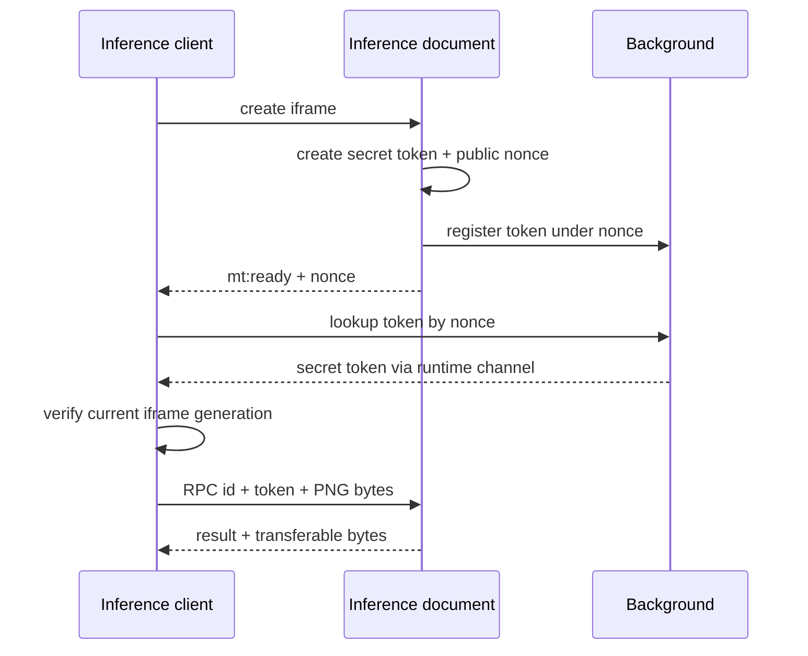
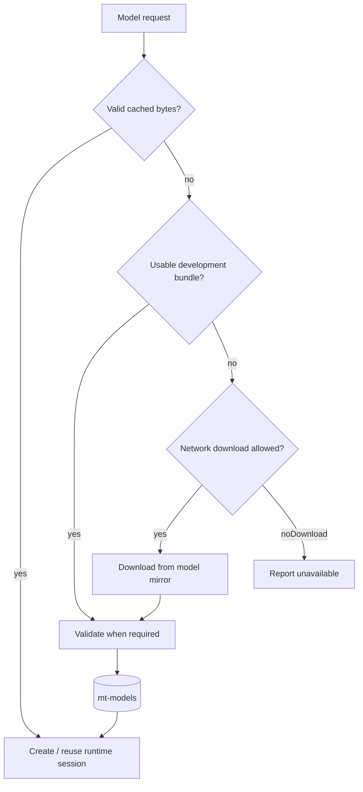

# Inference และวงจรชีวิตโมเดล

[English](../inference.md) | ภาษาไทย

> แปลจากฉบับอังกฤษ: 2026-10-15 · โค้ดอ้างอิง: `09dfec1`

[สารบัญ](README.md) · [ก่อนหน้า: Chapter translation](chapter-translation.md) · [ถัดไป: LLM และ context](llm-and-context.md)

## 1. วงจรชีวิตของ host

[iframe/worker.ts](../../src/iframe/worker.ts) รันใน [worker.html](../../src/iframe/worker.html)
ที่เป็น extension origin ทำให้โหลด packaged runtime/WASM และใช้ canvas preprocessing ได้
entry นี้เป็น iframe document ไม่ใช่ `new Worker()`
content/runner ติดต่อผ่าน [detection.ts](../../src/content/detection.ts)

เริ่ม host เมื่อมี local RPC เท่านั้น ไม่สร้าง ORT context ตอนเริ่ม Cloud หรือ cache-only workflow
งาน setup/encoding/RPC ที่ active ถือ resource lease และ chapter pump ถือ host ตลอดช่วง active
หลังไม่มีผู้ถือ host จึงใช้ idle disposal ดูข้อจำกัดการคืนหน่วยความจำใน
[Memory ownership](../performance.md)

## 2. Handshake และ RPC

หน้าเว็บกับ content script ใช้ page origin ร่วมกันสำหรับ postMessage
การตรวจ origin ของคำขออย่างเดียวจึงไม่พอแยก hostile page JS ออกจาก extension caller

worker รับเฉพาะข้อความที่ token ตรง ส่วน client ตรวจ source window และ extension origin
ready reply ที่รอ token lookup อยู่ต้องถูกทิ้งหาก iframe ถูกเปลี่ยนระหว่าง await
key เป็น nonce ไม่ใช้ `sender.tab` เพราะ runner/extension documents อาจไม่มี tab

handshake มี timeout และ bounded healing เมื่อ token หาย
RPC timeout ต้อง destroy computing frame และ reject pending siblings ไม่ใช่เพียงลบ callback ของคำขอนั้น
ดู [inference-health.ts](../../src/content/inference-health.ts) สำหรับการแยก worker timeout ออกจาก browser-wide GPU non-response

## 3. โมเดลและ providers

| งาน | โมเดล / input | Local execution | หมายเหตุ |
| --- | --- | --- | --- |
| Layout default | KoharuLayout FP32, 1152×1152 | WebGPU; session-create fallback เป็น WASM | text/SFX/bubble/panel ใน model เดียว; Cloud ใช้ export เดียวกัน |
| Layout alternative | CTD dynamic INT8, letterbox 1024×1024 | WebGPU; session-create fallback เป็น WASM | boxes + text probability mask |
| CTD panel ordering | YOLO26n, resize 640×640 | WASM | class 0; graph มี NMS แล้ว ไม่ทำ NMS ซ้ำ |
| OCR | Baberu vision 224×224 + prefill + step | vision WebGPU→WASM, decoders WASM | ต้องมี model files/vocab ครบ |
| OCR alternative | Tesseract.js | packaged worker + WASM | ติดตั้ง traineddata ตามภาษา |
| AI cleanup | Manga-LaMa FP16 weights, 512×512 windows | WebGPU เท่านั้น | ใช้ไม่ได้ให้ renderer พิจารณา built-in fill |

`detEp='wasm'` บังคับ layout detector ใช้ CPU provider ไม่ได้บังคับให้ทุกโมเดลอื่นเปลี่ยนเป็น WASM
เช่น local AI cleanup ยังต้อง WebGPU

WASM runtime ตั้ง `ort.env.wasm.numThreads = 1` เพราะ host นี้ไม่อยู่ใน cross-origin-isolated environment
การเพิ่ม concurrency ของหน้าไม่ทำให้ WASM inference กลายเป็น multithreaded

## 4. KoharuLayout path

metadata ที่รองรับอยู่ใน [layout-model.ts](../../src/layout-model.ts)
ปัจจุบันเป็น `koharu-fp32-q256-v3`, file `koharu-fp32-chunked.onnx`, 149,799,163 bytes
ต้องตรงทั้งขนาดและ SHA-256 ไม่ใช่แค่ชื่อไฟล์เหมือนกัน

[koharu.ts](../../src/iframe/koharu.ts) จัดการ preprocessing และ output geometry:

1. RGB float antialiased bilinear resize โดยรักษา FP32 arithmetic ที่เกี่ยวข้อง
2. ImageNet normalization และ NCHW tensor `[1,3,1152,1152]`
3. ตรวจ output dimensions/lengths/finite values:
   `dets=[1,300,4]`, `labels=[1,300,5]`, `masks=[1,300,288,288]`
4. Sigmoid class scores, เลือก candidates และ thresholds
5. Text/SFX instance masks รวมเป็น text mask; bubble/panel masks ไม่ปะปนเป็น erase ink
6. Bubble shapes เก็บเป็น row spans เพื่อช่วย layout โดยรักษา holes และ disconnected pieces

การตรวจพบ SFX ไม่ได้แปลว่าต้องลบ/แปลทั้งหมด การตัดสินใจ `keep` ยังเป็น contract ของ translation/render
สำหรับ extreme-aspect page ใช้ shared tiling และคืน panel fallback เพราะ tile panels ไม่ใช่ full-page panel topology

เมื่อสลับ Koharu↔CTD/panel worker มี layout lock ครอบการยืม/ปล่อย session
จึงไม่ release session ระหว่าง page/tile อื่นยังใช้ และไม่เก็บ Koharu กับ CTD/panel sessions ทับกันโดยไม่จำเป็น
ดู [Koharu export/install](../koharu-layout.md) สำหรับ recipe และ model licensing

## 5. CTD, tiling และ reading order

CTD preprocess รักษา aspect ratio ด้วย letterbox 1024 และแยก box-head ออกจาก probability mask
postprocess รวม confidence/NMS, connected components, grouping/splitting และ text-mask recovery
เพื่อแยก text groups ที่ merged และลด fragments ที่ทำให้วาดคำแปลซ้ำ

ภาพที่ aspect ratio เกิน 3 ในแกนใดแกนหนึ่งแบ่ง tiles ที่ target 1200 px พร้อม overlap 180 px
merge boxes/masks กลับสู่ page coordinates ก่อนขั้นต่อไป
เมื่อเปลี่ยน recipe ต้องเทียบ output geometry ด้วย

panel model output `[1,300,6]` มี NMS ใน graph แล้ว ใช้ class 0 และ threshold จาก settings
`orderDetection` ไม่เรียก panel model สำหรับ strip ที่ย่อ 640 แล้ว geometry ไม่น่าเชื่อถือ
และถ้า panel ไม่ usable จะกลับไป text-position banding

การเปลี่ยน split/grouping/mask recipe ต้องปรับ Python mirror และตรวจ cache generations ด้วย

## 6. OCR

### Baberu

model files ประกอบด้วย vision, prefill, step และ vocab; runtime ไม่จำเป็นต้องดาวน์โหลดเองทุก OCR call
UI/model manager เตรียมไฟล์ใน `mt-models` แล้ว `baberuInstalled` ตรวจความพร้อมก่อน workflow ใช้

OCR crop ขยายพอรักษาหาง glyph โดยใช้ original pixels
Baberu อ่าน vertical text โดยไม่หมุน/binarize แบบ Tesseract
decoder เป็น greedy พร้อม repetition penalty 1.2, content run cap 12 และสูงสุด 128 steps

prefetch crops แบบจำกัดจำนวนช่วยให้งาน crop/encode/message ซ้อนกันได้
ส่วน ONNX execution ยังผ่าน inference lock

### Tesseract

engine, worker script และ SIMD-LSTM core ถูก copy จาก dependencies เข้า build
เฉพาะ language data ดาวน์โหลดจาก configured public mirrors
worker ใช้ `workerBlobURL: false` และ explicit packaged worker/core paths
เพื่อไม่รับ page CSP ของ blob wrapper ที่บล็อกการโหลด extension script

## 7. Locking และ priority

`withInferLock` เป็น shared ORT queue **ภายใน inference document** ครอบ session create/run/release ที่ใช้ร่วมกัน
foreground priority 0 มาก่อน background priority 1 แต่ไม่ preempt inference ที่เริ่มแล้ว
decode/preprocess/postprocess ไม่จำเป็นต้องถือ ORT lock ตลอด
อีก lock คือ `withLayoutLock` สำหรับ model switching ของ layout detector

แยกตัวเลขเมื่อวัดเวลา:

- session initialization รวม model upload/shader compilation
- elapsed inference wrapper อาจรวมรอ lock
- cumulative lock-wait delta ไม่ใช่ isolated kernel time เมื่อมีงานแทรก
- total page time ยังมี CPU pixels/layout/PNG encode และ LLM network

## 8. Model storage, downloads และ repair

แหล่งปกติคือ IndexedDB → optional development bundle → mirror
release build ไม่แพ็ก ONNX weights แต่แพ็ก executable runtime/WASM ที่จำเป็น
`noDownload` ห้ามเริ่ม remote model download แต่ยังใช้ local bundle ที่มีอยู่ได้

- [ocr-models.ts](../../src/llm/ocr-models.ts): shared model/data downloads, stall detection และ bounded retries
- [layout-models.ts](../../src/llm/layout-models.ts): Koharu exact size/hash, import, download และ integrity repair
- Download ใหม่แบบ force ข้าม stored bytes/HTTP cache และ commit หลังไฟล์ใหม่พร้อม
- Koharu repair ตอบสนอง integrity error โดยเฉพาะ ไม่ตีความ crypto/runtime exception ทุกชนิดว่าไฟล์เสีย
- CTD/panel/Baberu ใช้ validators ต่างจาก exact size/SHA-256 check ของ Koharu
- Delete ใน model manager ลบ persisted installation; optional dev bundle ไม่ใช่สิ่งที่ UI Delete ลบทิ้งจาก extension package ได้

## 9. เอกสารอ้างอิงและ tests

- [ONNX Runtime WebGPU EP](https://onnxruntime.ai/docs/execution-providers/WebGPU-ExecutionProvider.html)
- [Environment flags และ session options](https://onnxruntime.ai/docs/tutorials/web/env-flags-and-session-options.html)

tests: [worker-handshake](../../tests/worker-handshake.test.mjs), [inference-host](../../tests/inference-host.test.mjs),
[worker-resources](../../tests/worker-resources.test.mjs), [koharu](../../tests/koharu.test.mjs),
[koharu-model-store](../../tests/koharu-model-store.test.mjs), [model-download-repair](../../tests/model-download-repair.test.mjs)

เมื่อตรวจใน browser ให้ดู effective provider, decoded pixels, finite model outputs
และภาพที่ render บนเครื่องปลายทาง
