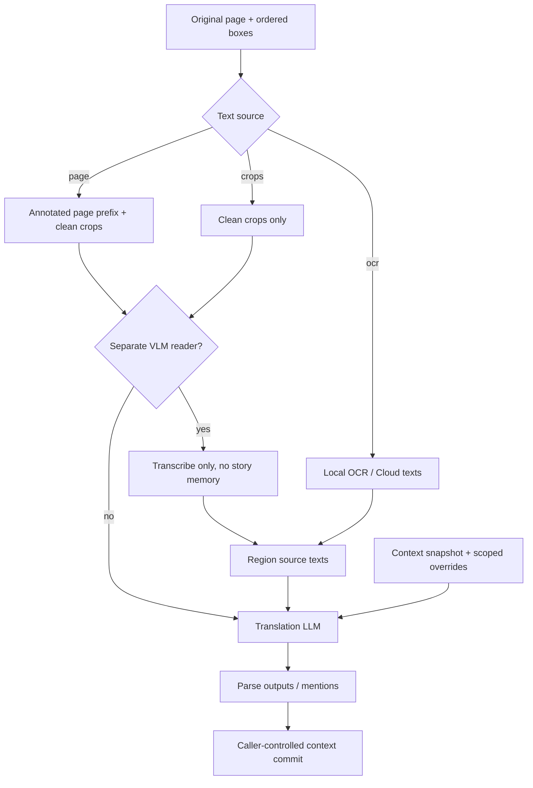

# LLM, prompt และ context

[English](../llm-and-context.md) | ภาษาไทย

> แปลจากฉบับอังกฤษ: 2026-10-15 · โค้ดอ้างอิง: `09dfec1`

[สารบัญ](README.md) · [ก่อนหน้า: Inference](inference.md) · [ถัดไป: Rendering](rendering.md)

## 1. แยก domain logic ออกจาก transport

| Module | Responsibility |
| --- | --- |
| [content/ocr.ts](../../src/content/ocr.ts) | อ่าน source, สร้าง page/crop payload, chunk mapping และ translation RPC |
| [background.ts](../../src/background/background.ts) | โหลด endpoint settings, overrides, retry/dedup, optional VLM-reader stage และส่งผลกลับ |
| [llm/core.ts](../../src/llm/core.ts) | prompt construction, response parsing, character matching/merge และ context updates แบบ pure |
| [llm/adapters.ts](../../src/llm/adapters.ts) | แปลง prompt/images เป็น HTTP ของแต่ละ protocol และ normalize text/usage/errors |
| [chapter-context.ts](../../src/background/chapter-context.ts) | serialize context persistence และ replay contributions ของ chapter |

เรียก HTTP ด้วย fetch โดยตรง แต่ละ endpoint รับ credential ของตัวเองและข้อมูลตาม workflow
ไม่มี backend ของผู้พัฒนาเก็บ API key

## 2. Text-source contract



`page` ให้โมเดลอ่าน **crop** และใช้ annotated page เป็นบริบท/speaker cues
ตัวเลขกรอบ annotation ไม่ใช่ข้อความมังงะ และไม่ควรเป็นสิ่งที่โมเดลแปล
`crops` ไม่มี surrounding artwork จึงให้ speaker evidence น้อยกว่า
`ocr` ไม่มีภาพใน translation call แต่ Cloud หรือ separate reader อาจรับภาพใน stage ก่อนหน้าอยู่ดี

## 3. Region numbers, marker numbers และ image positions

เลข region และตำแหน่งภาพใน payload ใช้คนละหน้าที่:

| ค่า | ความหมาย |
| --- | --- |
| `RegionInput.index` | output `n` ที่คำตอบต้องใช้ใน request นั้น |
| `page` | ตำแหน่ง full-page image ของ region ใน merged request |
| `marker` | badge ที่ติดอยู่บน annotated page; คงเดิมเมื่อ retry เฉพาะบาง regions |
| `crop` / `image` ใน prompt | ตำแหน่งภาพจริงใน payload ไม่จำเป็นต้องเท่ากับ marker |
| `RegionOutput.index` หลัง map กลับ | region ของ original page ที่ renderer จะใช้ |

ตัวอย่าง: retry เฉพาะ region 3 และ 7 ต้องส่ง crops ที่ตรงสองรายการนั้น
ไม่ส่ง crop ตำแหน่ง 3/7 ด้วยการ index array ที่มีแค่สองภาพ
`subsetRegionImages`, `requestImages`, `transcribeCropImages` และ chunk-local→global mapping รักษา contract นี้

Page mode วาง full-page images ทั้งหมดไว้หน้าชุด crops
per-region transcription fallback จึงต้องข้าม **pageCount** ภาพ ไม่ใช่ข้ามเพียงภาพแรกเสมอ

## 4. โครงสร้าง prompt

`BuiltPrompt` มี `system` และ `user` แยกกัน:

- `system`: task, output schema, ความครบถ้วนของคำแปล, language/style rules และวิธีใช้ภาพ
- `user`: known characters, recent pairs, dimensions/content rectangle เมื่อใช้ extras และ region data

instructions ที่คงที่อยู่ก่อน book/pairs/regions ที่เปลี่ยนทุกหน้า เพื่อรองรับ prefix caching
การรองรับ cache และราคาขึ้นอยู่กับ provider

`useContext` และ `useCharacters` แยกการส่ง pairs/book ส่วน `shareContext` ปิด context snapshot ทั้งชุดสำหรับงานนั้น
`stylePrompt` เพิ่ม tone instruction ไม่แทนกฎเรื่องความครบถ้วนหรือ numbering
prompt ไม่ใช้ตัวเลขพื้นที่/character budget เพื่อบังคับย่อความหมายให้พอดี renderer

สำหรับ OCR-text มี `b=1` เมื่อ geometry ให้ positive balloon evidence และ `b=?` เมื่อไม่ทราบ
นี่ไม่ใช่ source text และไม่ใช่ label ยืนยันว่าเป็น speech/SFX
การแปล spoken reaction กับการ keep sound effect ต้องพิจารณาความหมาย ไม่ใช้ capitalization/script อย่างเดียว

## 5. Response schema และ parser

ตัวอย่างคำตอบเมื่อแปลเป็นไทย:

```xml
<r n="1" spk="c1" g="F">ไปด้วยกันไหมคะ</r>
<r n="2" keep="true"/>
<names>
<m name="อากิ" g="?">เพื่อนร่วมชั้น</m>
</names>
```

- `n` เป็น 1-based region id ที่ request ให้มา; sparse retry ต้องรักษา id ไม่ compact เป็นลำดับใหม่เอง
- `keep` หมายถึงรักษาต้นฉบับ เช่น no-readable-text, genuine SFX หรือ watermark ตาม prompt
- `src` เป็น exact source transcription เมื่อ workflow ขอ; ไม่ใช่ summary ของภาพ
- `spk` อ้าง stable roster id หรือ `new` พร้อม description เมื่อมีหลักฐาน
- `<names>` เป็น page-level mentions ไม่เท่ากับผู้พูดของแต่ละ region
- merge/correction/note ops มีเงื่อนไข evidence และห้ามล้ม confirmed user rows ตามกฎใน core

parser ยอมรับรูปแบบคลาดเคลื่อนบางชนิด เช่น preamble, self-closing/ไม่ปิด tag บางกรณี
และกรองเลข/พิกัดที่ใช้ไม่ได้ แต่ไม่ใช้ `eval` หรือแสดง raw answer เป็น HTML
คำตอบที่ parse ไม่ได้ไม่ควรถูกแจ้งว่าแปลสำเร็จแล้ว cache outputs ว่าง
missing/unplaceable regions ยังรักษาต้นฉบับใน renderer

## 6. Provider adapters

รูปแบบ request ที่รองรับ โดยแต่ละ endpoint อาจรับ options ต่างกัน:

| provider id | HTTP shape | ภาพ / instructions |
| --- | --- | --- |
| `openai` | `<base>/chat/completions` | image_url data URLs, system/user messages |
| `responses` | `<base>/responses` | input_image, `instructions` และ output message items |
| `anthropic` | Messages API | base64 image blocks, system และ ephemeral cache segments |
| `gemini` | `<base>/models/<model>:generateContent` | inline image data, systemInstruction |
| `cloudflare` | account AI `/run/<model>` | native run body และ result/error normalization |

`baseUrl` override และ defaults ดู [adapters.ts](../../src/llm/adapters.ts)
`responses` เป็นชื่อ protocol ไม่ได้บังคับว่าต้องใช้ endpoint ของ OpenAI เท่านั้น
API key placement ต่างกันตาม adapter เช่น Bearer, provider header หรือ query parameter
จึงไม่ควร log URL/headers ทั้งชุดเพื่อ debug

temperature/thinking ถูกแปลงตาม protocol; ถ้า provider ปฏิเสธ option ที่มี fallback
adapter อาจ retry โดย omit/แปลง option อย่างมีขอบเขต
Test thinking บอกว่า request ถูก **ยอมรับ** ไม่ได้พิสูจน์ว่า server ใช้ reasoning level นั้นจริง

optional output caps ของ OpenAI-compatible/Responses/Gemini ไม่ถูกตั้งเป็นค่าเริ่มต้นเหมือนกันทุก protocol
Anthropic/Cloudflare ยังมีค่าที่ implementation ต้องส่ง
อย่าเพิ่ม generic max_tokens เพื่อแก้ reply ว่างโดยไม่ตรวจ reasoning/finish reason ของ provider

## 7. Retry แต่ละชั้น

| ชั้น | Trigger | ขอบเขต |
| --- | --- | --- |
| Adapter compatibility | rejected role/cache-key/thinking/temperature ที่เข้าเงื่อนไข | เปลี่ยน representation/omit option ไม่ใช่ retry 429 |
| Background HTTP | network/5xx | retry สูงสุดสองรอบเพิ่ม พร้อม backoff 1s/4s |
| Empty reply | successful HTTP แต่ text ว่าง | retry ใน call ที่ opt-in ได้หนึ่งครั้ง |
| Response completeness | parse บางส่วน/ไม่ได้เลย | missing-only หรือ full parse retry ตามเส้นทาง |
| Content chunking | `parse` failure ของหลาย regions | ลดชุดลงประมาณครึ่งและจำขนาดใน script instance |
| RPC transport | background disconnected/no receiver/timeout ตามเงื่อนไข | bounded channel fallback; ไม่ถือว่า provider error ทุกชนิด retry ได้ |
| Chapter group | combine/group failure หรือ lease | fallback per-page เมื่อไม่ใช่ shared-failure halt |

จำนวน HTTP requests จริงจึงอาจมากกว่าจำนวนหน้า/กลุ่ม ผู้ใช้สามารถถูกคิดเงินจาก attempts ที่ไม่มี usable answer ได้
usage ที่ provider รายงานควรรวม discarded attempts เท่าที่เส้นทางนั้นรับมา ไม่ใช้จำนวน pages ประเมิน billing แทน

Auth/quota/429 หยุด Auto/chapter จนกว่าผู้ใช้จะสั่งต่อ
adapter เก็บ refusal window แยกตาม provider/base URL

Separate VLM reader เริ่ม batched; หากรู้ว่าจำกัดภาพหรือถูกบังคับ per-region จึงใช้หนึ่ง crop ต่อ call
capabilities ที่เรียนรู้จำใน background lifetime ไม่ใช่ permanent model catalog
transcript interim message ช่วยบันทึก checkpoint ก่อน translation stage ยาว ๆ

## 8. Request deduplication และ prompt caching

มีการ cache ที่ต้องแยกสามแบบ:

1. **Full translation cache**: persisted outputs ของหน้าที่ตรง recipe/source
2. **In-flight/recent request dedup**: background แชร์คำตอบของ request fingerprint เดียวกัน
   และเก็บ successful replies แบบ bounded อายุ 5 นาที สูงสุด 20 entries ใน memory
3. **Provider prompt cache**: ช่วย reuse prompt prefix ฝั่ง endpoint ตาม protocol/model ของผู้ใช้

request fingerprint ครอบ input images, region/context และ settings ที่มีผลต่อ request
fresh Re-translate มี nonce เพื่อไม่รับคำตอบของ intent เก่า; cache generation แยกหลัง Clear
background restart ทำให้ in-memory dedup หาย จึงยังอาจเกิดการคิดเงินซ้ำได้

provider session/cache affinity ใช้ salted opaque identifier ไม่ส่ง raw chapter URL เป็น session field
endpoint ยังได้รับข้อความแปล/book/context ที่ผู้ใช้เลือกส่ง

## 9. Character book และ recent pairs

`ContextState` มีสองส่วน:

- `pairs`: source/translation และ optional speaker id สำหรับ recent narrative flow; chapter-scoped
- `characters`: stable id, description, gender, name/fullName, source, note และ absorbed rows

book รองรับคนที่ยังไม่มีชื่อแต่มี visual/role anchor; ไม่บังคับให้ทุกคนมีชื่อก่อนเรียนรู้
speaker ของ region กับคนที่ถูกกล่าวถึงใน `<names>` ต่างกัน
การ infer จาก crop-only/OCR มีหลักฐานจำกัด จึงต้องยอมเว้น speaker แทนเดา

merge policy ให้ user rows มี priority สูงกว่า learned rows, รักษา stable ids,
ไม่เดาชื่อเต็มจากชิ้นส่วนคนละหน้า และไม่ evict user rows เพื่อทำให้ถึง cap อย่างฝืนคำสั่งผู้ใช้
`absorbed` เก็บข้อมูลพอให้ UI Split คืนแถวที่ถูกรวมได้
user overrides ถูก scope ตาม book ก่อนใช้กับ prompt ไม่ใช้เป็น global replacement ข้ามทุกเรื่อง

`crossChapter` ใช้ story key เมื่อ resolve ได้ มิฉะนั้น fail-safe กลับ chapter key
pairs ไม่ตาม book ข้ามเรื่อง/บทไปด้วย ดู keys และ persistence ใน [Data](data-and-settings.md)

## 10. Commit และ replay โดยไม่เรียนรู้ผิดลำดับ

translation response เสนอ next context แต่ caller เลือกเวลา commit:

- Reader queue: snapshot ก่อนหน้า → translate/render → fold ครั้งเดียว; cached output fold ได้เมื่อยังไม่เคย fold ใน session
- Re-translate: ใช้ bookBefore/pairsBefore หรือ fallback replay เพื่อเอา contribution เดิมออกจากสิ่งที่ prompt เห็น
- Chapter: contributions ตาม page id/order อยู่ใน ledger; หน้าเดิมถูก replace ไม่ append ซ้ำ
- Concurrent chapter completion: replay ตาม reading order จาก base + contributions แล้วค่อย apply explicit edits

background context transaction serialize การอ่าน/แก้/เขียน ledger
ไม่ใช่การล็อก LLM requests ให้ serial ทั้งหมด
ผลช้าจาก chapter เก่าหรือ save revision เก่าต้องไม่แทน context ปัจจุบัน

tests: [llm](../../tests/llm.test.mjs), [translate-retry](../../tests/translate-retry.test.mjs),
[adaptive-chunk](../../tests/adaptive-chunk.test.mjs), [thinking](../../tests/thinking.test.mjs),
[ocr-balloon-hints](../../tests/ocr-balloon-hints.test.mjs), [chapter-order](../../tests/chapter-order.test.mjs)
