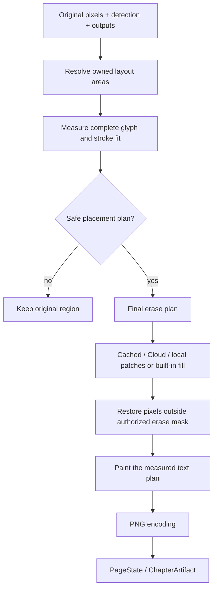

# Rendering, reading order และ geometry

[English](../rendering.md) | ภาษาไทย

> แปลจากฉบับอังกฤษ: 2026-10-15 · โค้ดอ้างอิง: `09dfec1`

[สารบัญ](README.md) · [ก่อนหน้า: LLM และ context](llm-and-context.md) · [ถัดไป: Data และ settings](data-and-settings.md)

## 1. ชนิดของ geometry

detector บอกตำแหน่งกลุ่มข้อความ ไม่ได้ให้พื้นที่ว่างที่ปลอดภัยสำหรับคำแปลเสมอ
กรอบเดียวอาจคร่อมหลายบอลลูน หรือหลายกรอบอาจอยู่ในบอลลูนใบเดียว
ข้อความแปลมีความยาว/สัดส่วนต่างจากต้นฉบับ จึงต้องวัด original pixels และแยก geometry หลายชนิด

| Geometry | ใช้ทำอะไร | ห้ามใช้แทน |
| --- | --- | --- |
| Detection box | ระบุกลุ่มข้อความและ crop/numbering | พื้นที่ว่างทั้งบอลลูน |
| Text mask | หลักฐานว่าพิกเซลใดเป็น glyph ink | mask ของภาพที่อนุญาตให้ลบทั้งหมด |
| Balloon surface | รูปร่างพื้นหลังที่ล้อมข้อความ | erase mask หรือ speech classifier |
| Ownership clip / cutAxis | จำกัดพื้นที่ของกลุ่มที่ถูกแยกจากกัน | กำแพงจริงในภาพ |
| Layout area / row profile | พื้นที่ที่ text block วางได้อย่างปลอดภัย | ขอบเขตที่ cleanup เปลี่ยน pixels ได้ |
| PreparedRender | layout และตำแหน่ง glyph ที่ผ่าน fit check | การวัดซ้ำด้วย recipe อีกชุดตอน paint |

## 2. Flow ที่รักษาต้นฉบับ

`paintRegions` ใน [pipeline.ts](../../src/content/pipeline.ts) เตรียม layout plans ก่อนลบต้นฉบับ
ถ้า translation มีแล้วแต่ glyph/stroke วางไม่ปลอดภัย จะรักษาต้นฉบับแทนลบให้เหลือช่องว่าง
regions ที่ `keep`, missing answer หรือ duplicate ที่ไม่มีแผนทดแทนต้องไม่ถูก erase อย่างเหมารวม

## 3. Reading order เกิดก่อนส่ง LLM

จัดลำดับก่อนกำหนดเลข region:

1. เลือก panel-aware ordering เมื่อ panel geometry usable
2. จัด topology ของ panels รวม nested/inset และช่องว่างที่ไม่ถูก detector จับเป็น panel
3. เรียงข้อความภายในตาม `readingDir`: RTL สำหรับ manga หรือ LTR สำหรับรูปแบบที่อ่านอีกทาง
4. หาก panel ไม่พอใช้/เป็น strip ใช้ position bands และ corridor splitting
5. small clustered labels อาจ defer ตาม setting เพื่อไม่แทรกระหว่างบทสนทนาหลัก

implementation อยู่ใน [detection.ts](../../src/content/detection.ts): `sortReadingOrder`,
`orderByPanels`, `panelReadingOrder`, `splitDeferred`, `panelsUsable`
ordering กำหนด region numbering/crops/prompt และ context
หากเปลี่ยนลำดับหลังแปลต้อง map indices ใหม่

## 4. Physical balloon surfaces และ text grouping

[balloon-surface.ts](../../src/content/balloon-surface.ts) หา enclosed background component จาก pixels
ใช้ tone ของพื้นหลัง, flood fill, enclosure evidence และ internal-divider checks
flood fill ต้องไม่ไหลผ่านตัวอักษรจนข้ามเส้นบอลลูน
การวัด surface ทำโดยไม่ถือ artificial clip ของเราเป็นขอบภาพจริง แล้วจึงค่อย apply ownership

งานที่ใช้ surface:

- แยกกลุ่มที่อยู่คนละ physical enclosure แม้ detection box แรกคร่อมทั้งคู่
- รวมบรรทัดที่เป็นข้อความกลุ่มเดียวเมื่อ geometry สนับสนุน ไม่รวมแค่เพราะอยู่ใกล้กัน
- แยก text blocks ของ connected/lobed balloon ที่ interior เชื่อมกันแต่ควรมี layout แยก
- หา per-row free spans สำหรับข้อความที่ต้องเข้ารูปโค้ง

Cloud ทำ grouping/refinement ที่เกี่ยวข้องฝั่ง server ก่อน OCR
เพราะหาก client เพิ่ง split หลัง server อ่าน text ไปแล้ว source strings จะไม่ตรง regions
Python mirror คือ [balloon_surface.py](../../server/balloon_surface.py)

## 5. Model balloons ของ Koharu

Koharu ส่ง bubble instance geometry เพิ่มจาก boxes/text mask
[model-balloon.ts](../../src/content/model-balloon.ts) จับคู่ shape กับ text region
โดยต้องครอบ source ink เพียงพอ ไม่ใช่แค่มี rectangle overlap เล็กน้อย

หากหลายกลุ่มใช้ bubble shape เดียวกัน จะจัดสรรพื้นที่ด้วย nearest-owner rule พร้อม deterministic tie-break
เพื่อไม่ให้แต่ละกลุ่มได้พื้นที่ทั้งใบซ้อนกัน
shape เก็บ half-open row spans พร้อม source dimensions จึง scale ตาม proportional rendition ได้

model balloon จำกัดขอบเขตค้นหาพื้นที่วาง renderer ยังตรวจ original pixels/tone/internal walls
ไม่ถือว่า mask ของโมเดลอนุญาตให้วาดทับ artwork หรือให้ลบ bubble ทั้งใบ
หาก shape ใช้ไม่ได้จะกลับ pixel-measured/fallback area

## 6. Layout area และ row profiles

[render.ts](../../src/content/render.ts) แยกการหา area ออกจากการ wrap/paint:

- `sourceBoxForLayout`: source ink geometry ที่เหมาะกับ layout
- `layoutArea`: เลือก modeled/pixel-measured area หรือ sparse-ink fallback แล้ว apply clip
- `surfaceProfile` / `widthProfile`: ช่วง x ที่แต่ละ row ใช้ได้ รวมการกัน fill leak
- `effBoxesForAreas`: ใส่ divider clips ให้ areas ของกลุ่มใกล้กันโดยไม่เปลี่ยน original erase boxes
- `pageArea`: clamp เข้าขอบ canvas และปฏิเสธพื้นที่เล็ก/degenerate

profile ไม่ใช่ rectangle ที่กว้างเท่าเดิมทุกบรรทัด
fit ต้องตรวจความกว้างตลอดแถบความสูงของ glyph/stroke ด้วย ไม่วัดแค่ centerline แล้วปล่อยสระ/วรรณยุกต์ชนขอบ
holes ภายใน profile มีความหมาย ห้ามขยายทับรูเพียงเพื่อทำให้ข้อความพอดี

## 7. Font sizing และการตัดคำไทย

1. เลือก font stack: Thai ใช้ bundled Sriracha เป็น default/fallback ส่วนภาษาอื่นใช้ system fonts
2. โหลด custom font ผ่าน extension font store และ apply family ที่โหลดแล้วทุกครั้งที่ configure settings
3. ประเมิน source pitch/glyph scale และ `textScale` เพื่อไม่ขยายข้อความเล็กจนใหญ่เกินหน้าตาเดิม
4. tokenize เป็น wrapping units, วัดด้วย canvas metrics และหา font/line layout ที่พอดี
5. ตรวจ actual glyph bounding boxes รวม stroke ก่อนสร้าง painter

Thai ใช้ `Intl.Segmenter('th', { granularity: 'word' })` ร่วมกับ generated correction data ใน
[thai-words.ts](../../src/content/thai-words.ts)
spaces จาก LLM ถือเป็น phrase boundaries; Thai units ไม่ถูกเติม spaces ระหว่างทุกคำ
`ๆ`/`ฯ` และ closing punctuation ต้องไม่ลอยขึ้นต้นบรรทัดอย่างไม่เหมาะสม
` / ` เป็น explicit break segments ตาม contract ของ layout

`minFont` กำหนดขนาดต่ำสุดปกติ แต่ขั้นสุดท้ายอาจย่อถึง `HARD_MIN_FONT=8`
หากยังวาง glyph/stroke ไม่ปลอดภัย จะคงต้นฉบับของ region นั้น

คำแปลวางตามแนวนอน: `chosenOrientation` คืน false
`verticalThreshold` มีผลกับ source/OCR geometry ไม่ใช่ทิศทางคำแปล

## 8. Cleanup: ลบเฉพาะที่มีสิทธิ์ลบ

[inpaint.ts](../../src/content/inpaint.ts) สร้าง erase plan จาก outputs และ original boxes
แล้วขยายขอบไปตาม mask ink ที่ต่อเนื่อง เพื่อเก็บ glyph ที่ยื่นนอก detector box
cleanup mask จำกัดตาม ownership clip และล้าง keep-box interiors ออก

| วิธี | การทำงาน | ข้อแลกเปลี่ยน |
| --- | --- | --- |
| Built-in fill | ลบ mask ที่ dilate แล้วด้วย background estimate/guards | ไม่ต้องโมเดลเพิ่ม แต่ไม่สร้าง texture แบบ generative cleanup |
| Local AI | Manga-LaMa รัน window ที่ย่อ 512 จาก original page | ต้อง WebGPU/model residency และรอ infer lock |
| Cloud AI | ใช้ patches ที่มากับ detect หรือ `/v1/inpaint` | มี upload/network และต้องรักษา coordinate/mask contract |
| Cached patches | reuse PNG crops ของ exact source rendition/patch generation | ใช้ข้าม encoding/rendition ไม่ได้เพียงเพราะเป็นหน้าเดียวกัน |

`inpaint='auto'` หมายถึง Cloud ใช้ AI เมื่อเลือก engine นั้น ส่วน local ใช้ fill โดย default
`on/off` เป็น explicit choice เพิ่มเติม

warm patches ระหว่างรอ LLM อาจคำนวณทุก box ก่อนรู้ว่าอะไรจะเป็น keep
ตอนใช้ต้อง filter ตาม erase set และ reject reuse เมื่อ keep overlap ไม่ปลอดภัย
หลัง draw patches `paintRegions` คืน original pixels นอก final authorized erase mask
เปลี่ยนได้เฉพาะ pixels ภายใน mask นี้

## 9. สี, extras และการ encode

auto text color ใช้ dominant/modal background tone โดยข้าม text-mask ink
ไม่ใช้ค่าเฉลี่ยทั้งบริเวณซึ่งอาจถูก artwork หรือ glyph เดิมดึงสีผิด
ผู้ใช้กำหนด text/stroke colors ได้ โดย auto stroke ใช้สีตรงข้ามกับ text ที่ resolve แล้ว

VLM extras คือข้อความที่โมเดลเสนอว่า detector อาจตรวจไม่พบ ต้องผ่านการตรวจ
content coordinates, overlap, light background และ ink density
โหมดนี้ปิดใน merged multi-page request

[encode.ts](../../src/content/encode.ts) รวม synchronous canvas encode utilities
สำหรับ full-page/crop เส้นทางที่ต้องหลีกเลี่ยง idle-scheduled encoder stalls
`withEncodeLock` จำกัด full-page encode pressure แต่ไม่ได้ serialize CPU work ทุกอย่างทั้งแอป
decoded patch ต้อง dispose/object URL revoke เมื่อจบหรือ batch อื่นล้มเหลว

## 10. การตรวจงาน renderer

- ดู original และ translated image จริง รวม Thai marks, clipped glyphs, overlapping groups และ reader rendition changes
- Debug overlay ใช้ geometry resolver เดียวกับ paint: source regions สีแดง, area สีเขียว, row profile สีส้ม
- `[mt] page result` ให้ layouts, mask/box metadata, cache reason และ effective render generation เมื่อ Debug เปิด
- เมื่อแก้ layout ให้ตรวจ `RENDER_GEN` และ artifact signatures โดยคำแปลที่ cache ไว้อาจยังใช้ได้

tests: [render](../../tests/render.test.mjs), [paragraph](../../tests/paragraph.test.mjs),
[balloon-surface](../../tests/balloon-surface.test.mjs), [model-balloon](../../tests/model-balloon.test.mjs),
[paint-geometry](../../tests/paint-geometry.test.mjs), [paint-patches](../../tests/paint-patches.test.mjs),
[reading-order](../../tests/reading-order.test.mjs), [panels](../../tests/panels.test.mjs)
