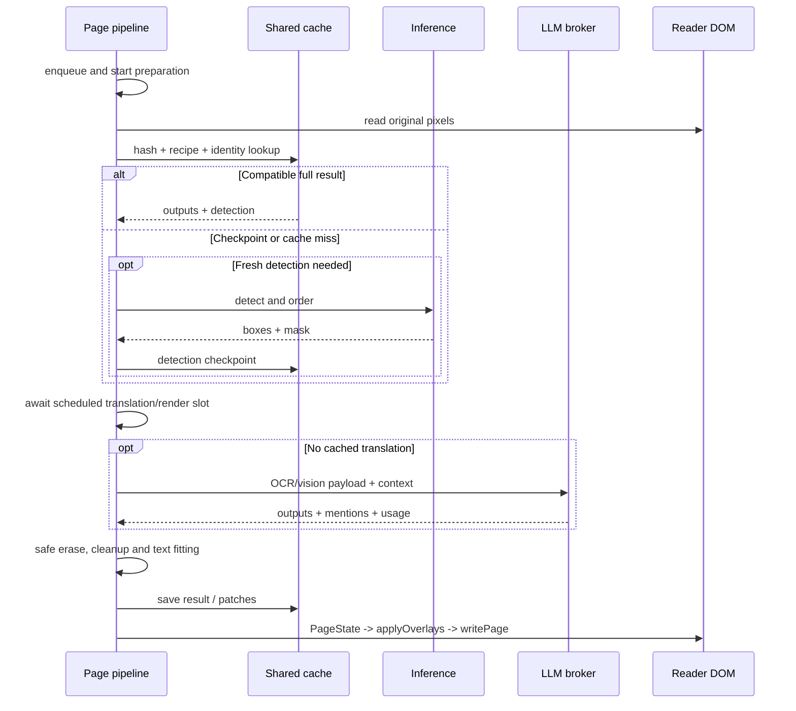

# Pipeline การแปลหนึ่งหน้า

[English](../translation-pipeline.md) | ภาษาไทย

> แปลจากฉบับอังกฤษ: 2026-10-15 · โค้ดอ้างอิง: `09dfec1`

[สารบัญ](README.md) · [ก่อนหน้า: Architecture](architecture.md) · [ถัดไป: Reader integration](reader-integration.md)

## 1. เส้นทางหลักของหนึ่งหน้า

เส้นทางของ manual/Auto แบบมี DOM เริ่มที่ `commands` หรือ `auto` แล้วเข้า queue ร่วมกัน
chapter ใช้ preparation/scheduler ของตัวเอง แต่เรียก detection, translation และ renderer ชุดเดียวกัน
บทนี้ไล่เส้นทางหนึ่งหน้าก่อน ส่วนการจัดหลายหน้าดู [Chapter translation](chapter-translation.md)

cleanup เริ่มระหว่างรอ LLM ได้ แล้วนำผลมาใช้ตอน render

## 2. รับ intent และเลือกหน้า

[commands.ts](../../src/content/commands.ts) แยกคำสั่ง popup ที่แปล visible spread
ออกจาก context menu ที่ชี้ภาพเฉพาะ ใช้ viewport overlap แบบพื้นที่สองแกน
เพื่อจัด priority ของหน้าที่เรียงตามแนวนอนได้ถูกต้อง

- Translate ปกติ reuse คำแปลเดิมเมื่อเข้ากันได้กับ source/settings
- Re-translate ขอผลใหม่สำหรับหน้าปัจจุบัน โดยข้าม full cache และ detection checkpoint
- หาก chapter runner เป็นเจ้าของหน้าอยู่ จะส่งคำขอให้ owner แทนสร้างงานคู่ใน reader queue
- Show original เปลี่ยนภาพที่แสดงโดยไม่ลบคำแปล ผลที่เสร็จทีหลังต้องไม่เปลี่ยนตัวเลือกนี้

ดูขอบเขตปุ่มที่ผู้ใช้เห็นใน [Translation controls](../translation-controls.md)

## 3. Preparation เกิดตั้งแต่ enqueue

`enqueue` สร้าง AbortController และเริ่ม `preparePage` ทันที เพื่อให้การอ่านภาพ/detect หน้าใหม่
ซ้อนกับ LLM ของหน้าก่อนหน้าได้ Queue ยัง deduplicate ตาม page key ไม่ใช่เพียง object ของ DOM element

`preparePage` ใน [pipeline.ts](../../src/content/pipeline.ts) ทำตามลำดับนี้:

1. รับ cache generation และตรวจ state เดิม หากแปลแล้วและไม่ได้ force ให้จบแบบ no-op
2. ตรวจ chapter/settings แล้วเลือก source เดิม ไม่ใช้ `img.src` ที่กลายเป็น translated Blob
3. `readPage` อ่าน original bytes/bitmap ตาม reader type; canvas placeholder ที่ยังว่างไม่ควรถูกถือว่าแปลสำเร็จ
4. สร้าง content hash จากภาพย่อ และ recipe fingerprint จาก settings
5. เมื่อเป็น Auto อาจรอ chapter owner ของหน้าเดียวกัน แทนการทำ detection/LLM ซ้ำ
6. ลอง full result ของ pixel key; หากต้องใช้ page-slot candidate ต้องตรวจภาพด้วย
7. หากไม่มี full hit ลอง resumable detection/OCR checkpoint
8. หากยังไม่มีผลที่ใช้ได้ ให้ detect, order และบันทึก checkpoint เมื่อมี text boxes

ผล `Prep` ถือ source bitmap, detection, hash, fingerprint, generation,
สถานะ cache/resume และข้อมูลเวลา Caller เป็นผู้รับผิดชอบปิด bitmap เมื่อหมดงาน

### Cache hit ยังต้องทำงานอะไร

full hit ข้าม detection/OCR/LLM ได้ แต่ยังอาจต้องตรวจ source, decode, โหลด font,
จัด layout ใหม่, ทำ cleanup patches ที่ยังไม่มี และ encode PNG
ดู [Cache](../cache.md) และ [Performance](../performance.md)

## 4. Detection และ reading order

`detectPage` เลือก local หรือ Cloud อย่างชัดเจน:

- Local ส่ง original pixels ให้ inference iframe โดยเลือก Koharu หรือ CTD
- Cloud ส่งผ่าน background ไป `/v1/page` และ scale ผลกลับสู่พิกัด original page
- Cloud ที่ config ไม่ครบ/เรียกไม่สำเร็จเป็น error ไม่ใช่ trigger ให้รัน local เงียบ ๆ

`orderDetection` ปรับ text grouping และจัดลำดับก่อนสร้าง region numbers:

- Cloud ใช้ Koharu panels ที่ server ส่งกลับ หรือ text-position banding สำหรับ CTD/strips โดยไม่เรียก panel model ในเครื่อง
- Koharu ใช้ panels ที่โมเดลเดียวกันส่งมา ถ้าไม่เหมาะสมจึง fallback
- Local CTD ใช้ YOLO panel เมื่อ aspect ratio เหมาะสม มิฉะนั้นใช้ banding
- เมื่อลำดับ boxes เปลี่ยน ต้องย้าย Cloud texts/patch indices ตาม box เดิมด้วย

รายละเอียด model และ geometry อยู่ใน [Inference](inference.md) และ [Rendering](rendering.md)

## 5. Queue, context และ concurrency

[queue.ts](../../src/content/queue.ts) แยก preparation ที่เริ่มล่วงหน้าออกจากงาน LLM/render ที่รอคิว
หน้าที่ผู้ใช้อยู่มี priority ตาม viewport overlap

- **เมื่อแชร์ context** เส้นทาง reader queue ประมวลผลแบบ serial เพื่อให้ book/pairs สะสมอย่างมีลำดับ
- **เมื่อปิดแชร์ context** จึงใช้ `parallelLlm` ทำหลายหน้าพร้อมกันได้
- Force jobs ต้อง rewind/replay context จึงไม่เข้ารอบ parallel ปกติ
- Cache-hit ที่เคย fold แล้วอาจแยกเข้า bounded paint lane เพราะไม่ต้องรอ LLM หรือเขียน book ซ้ำ
- `claimPaint` ป้องกัน renderer สองเส้นทางทำ cleanup และเขียนผลหน้าเดียวกันพร้อมกัน

chapter runner ใช้ rolling slots และ context snapshots แยกจาก reader queue

บางหน้าของ vertical reader มีข้อความข้ามรอยต่อ [seam.ts](../../src/content/seam.ts)
ตรวจ geometry/mask ก่อนยืมภาพข้างเคียง stitch, detect/translate/render แล้ว slice กลับ
ถ้าทำไม่ได้จะกลับเส้นทางหน้าเดี่ยว ไม่ได้รวมทุกหน้าที่อยู่ติดกันโดยอัตโนมัติ

## 6. OCR/vision payload และ LLM

[translateRegions](../../src/content/ocr.ts) สร้าง region list เป็น 1-based และเลือกข้อมูลที่จะส่ง:

| โหมด | สิ่งที่อ่าน source | สิ่งที่โมเดลแปลได้รับ |
| --- | --- | --- |
| `crops` | VLM แปลอ่านภาพเฉพาะ text crops | crop ต่อ region + prompt/context |
| `page` | VLM แปลอ่าน crops โดยใช้หน้าเต็มช่วยบริบท | annotated page(s) นำหน้า แล้วตามด้วย clean crops |
| `ocr` | Baberu/Tesseract ใน local หรือข้อความจาก Cloud | source text ต่อ region ไม่ส่งภาพใน translation call |
| Separate VLM reader | VLM ตัวอ่านถอดข้อความก่อน | ตัวอ่านรับภาพ; โมเดลแปลรับข้อความที่ถอดแล้ว |

OCR checkpoint บันทึกหลังอ่านสำเร็จเพื่อไม่ต้องอ่านใหม่เมื่อขั้นแปลล้มเหลว
การปิด full translation cache **ไม่ปิด checkpoint ระหว่างงาน**

translation RPC ใช้ port `mt-rpc` รองรับ transcript ระหว่างทาง และ fallback ช่องทางข้อความเมื่อ background หลุด
background ดูแล HTTP protocol, retries และ request dedup จากนั้นส่ง outputs/mentions/usage กลับมา
หาก parse ไม่ได้ทั้งชุด content อาจแบ่ง region เป็นชุดเล็กลงอย่างมีขอบเขต
รายละเอียดอยู่ใน [LLM และ context](llm-and-context.md)

## 7. Render, persistence และ attach

[renderPage](../../src/content/render-page.ts) ประกอบผลของหน้า:

1. เลือก context ก่อนหน้าและรับ cached outputs หรือเรียก translation แบบยังไม่ fold
2. เตรียมพื้นที่วางและ erase plan ที่รักษา `keep`/missing/unsafe regions
3. ใช้ cleanup patches จาก cache/Cloud/local เมื่อใช้ได้ มิฉะนั้นใช้ built-in fill
4. โหลด font และวาดคำแปลลง OffscreenCanvas ที่เริ่มจาก original pixels
5. Encode PNG แล้วสร้าง `PageState` ที่ถือ translated URL และ original identity
6. ลงทะเบียน state, fold context อย่างไม่ซ้ำ และบันทึก full cache เมื่ออนุญาต
7. Queue เรียก `applyOverlays`; `writePage` จึงเปลี่ยนภาพที่ผู้ใช้เห็นจริง

Local AI cleanup สามารถเริ่มหลัง OCR ระหว่างรอ network LLM แล้ว reuse patch ตอน render
แต่ต้องตรวจว่า patch ไม่ทำลาย region ที่ภายหลังคำตอบระบุ `keep`

ตรวจ identity อีกครั้งก่อน attach เพราะ reader อาจเปลี่ยน element หรือ source ระหว่าง render

## 8. Failure, Stop และผลที่มาช้า

| เหตุการณ์ | พฤติกรรมที่ควรรักษา |
| --- | --- |
| อ่านต้นฉบับไม่ได้ | แสดง error; ห้ามแปลจากภาพที่เราวาดเอง |
| ไม่พบ text boxes | ไม่เรียก LLM; chapter สามารถนับหน้าพร้อมอ่านโดยไม่สร้าง artifact ที่ไม่จำเป็น |
| OCR models ไม่ได้ติดตั้ง | แจ้งให้ติดตั้งหรือเปลี่ยน workflow ไม่ส่ง source ว่างไปแปลเงียบ ๆ |
| Provider auth/429 | หยุด Auto/งาน chapter ตาม shared-failure policy รอ user intent |
| Missing regions | ลองขอเฉพาะที่ขาด; region ที่ยังไม่มีคำตอบต้องคงต้นฉบับ |
| AI cleanup ใช้ไม่ได้ | renderer มี built-in fill fallback; ไม่เท่ากับ Cloud detection fallback |
| Stop / cache clear / เปลี่ยนเจ้าของ | revoke งาน และไม่ให้ late result กลับมาวาด/เขียนข้อมูลใน state ใหม่ |

AbortController, `valid()` และ cache generation ป้องกันการนำผลที่หมดสิทธิ์มาใช้
แต่ไม่ใช่ทุก operation จะหยุด compute หรือ HTTP request ที่รับไปแล้วได้ทันที
โดยเฉพาะ provider อาจยังคิดเงินสำหรับคำขอที่รับไปก่อน Stop

## 9. Tests

- [page-io.test.mjs](../../tests/page-io.test.mjs): source precedence และ screenshot fallback
- [cache-policy.test.mjs](../../tests/cache-policy.test.mjs): full/checkpoint/identity gates
- [stop-cancel.test.mjs](../../tests/stop-cancel.test.mjs), [ocr-cancellation.test.mjs](../../tests/ocr-cancellation.test.mjs): cancellation ก่อน dispatch/fold
- [prepared-job.test.mjs](../../tests/prepared-job.test.mjs): late preparation และ bitmap ownership
- [render-cache.test.mjs](../../tests/render-cache.test.mjs), [paint-claim.test.mjs](../../tests/paint-claim.test.mjs): cached render และ writer ownership
