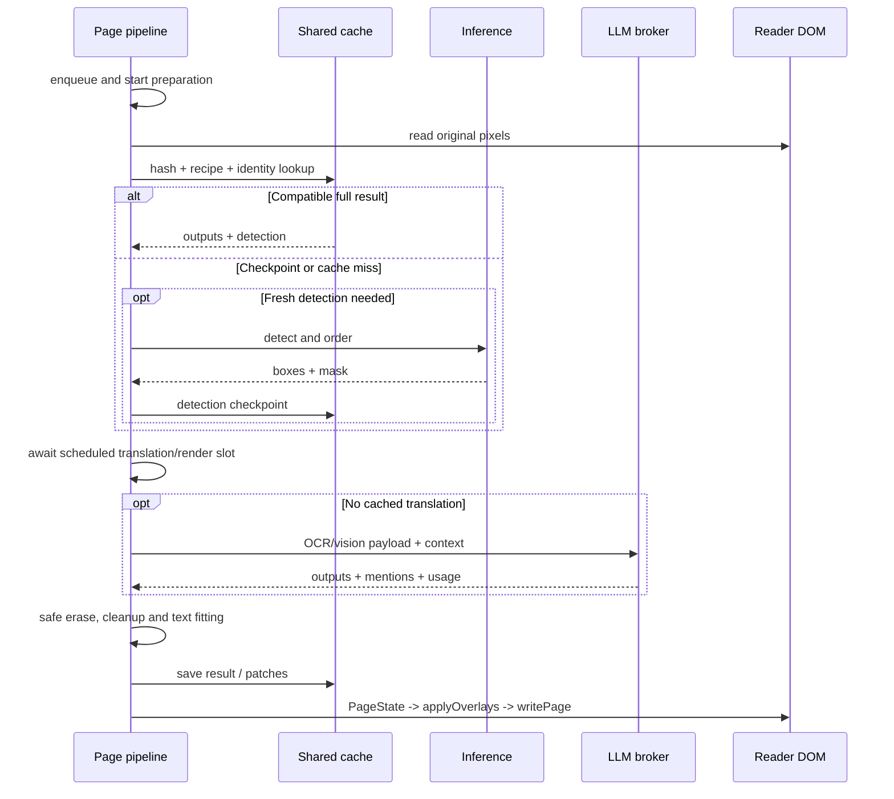

# Page translation pipeline

English | [ภาษาไทย](th/translation-pipeline.md)

[Index](README.md) · [Previous: Architecture](architecture.md) · [Next: Reader integration](reader-integration.md)

## 1. A page's main path

DOM-backed manual/Auto work starts in `commands` or `auto` and enters a shared queue.
Chapter work has its own preparation/scheduler but calls the same detection,
translation and rendering logic. This guide follows one page; multi-page scheduling
is covered in [Chapter translation](chapter-translation.md).

Cleanup can start during the LLM wait and be reused when rendering.

## 2. Intent and page selection

[commands.ts](../src/content/commands.ts) distinguishes a popup action on the visible
spread from a context-menu action targeting one image. Visibility uses two-dimensional
viewport overlap, so horizontally arranged pages do not all appear equally visible.

- Normal Translate reuses existing translations when compatible.
- Re-translate requests a fresh result for the current page, bypassing full cache and detection checkpoints.
- If a chapter runner owns the page, the command goes to that owner instead of duplicating work in the reader queue.
- Show original changes the display without deleting the translation. Later completions must respect that choice.

See [Translation controls](translation-controls.md) for user-facing command scope.

## 3. Preparation starts at enqueue

`enqueue` creates an AbortController and starts `preparePage` immediately, allowing
new image reads/detection to overlap the previous page's LLM call. Deduplication
uses page keys, not just DOM object identity.

`preparePage` in [pipeline.ts](../src/content/pipeline.ts):

1. Captures the cache generation and checks existing state; an already translated, non-force page is a no-op.
2. Checks chapter/settings and selects the original source, not an `img.src` now pointing at our translated Blob.
3. Uses `readPage` for original bytes/bitmap; an empty canvas placeholder must not count as translated.
4. Computes a thumbnail-based content hash and settings recipe fingerprint.
5. For Auto, may wait for a chapter owner of the same page rather than duplicate detection/LLM work.
6. Looks for a full pixel-key result; page-slot candidates require image verification too.
7. Without a full hit, tries a resumable detection/OCR checkpoint.
8. Otherwise detects, orders and saves a checkpoint when text boxes exist.

`Prep` carries the source bitmap, detection, hash, fingerprint, generation,
cache/resume flags and timings. Its caller owns closing the bitmap after use.

### What a cache hit still does

A full hit can skip detection/OCR/LLM, but source verification, decoding, font
loading, layout, missing cleanup patches and PNG encoding may still be needed.
See [Cache](cache.md) and [Performance](performance.md).

## 4. Detection and reading order

`detectPage` explicitly selects local or Cloud:

- Local sends original pixels to the inference iframe using Koharu or CTD.
- Cloud goes through the background to `/v1/page` and restores original-page coordinates.
- Missing/failed Cloud configuration is an error, not a reason to run local silently.

`orderDetection` refines text grouping and orders boxes before assigning region numbers:

- Cloud uses returned Koharu panels or text-position banding for CTD/strips, without a local panel model.
- Koharu uses panels from its own model, falling back when unsuitable.
- Local CTD uses YOLO panels for suitable aspect ratios, otherwise banding.
- Reordering boxes must move Cloud texts and patch indices with the original box objects.

See [Inference](inference.md) and [Rendering](rendering.md) for models and geometry.

## 5. Queue, context and concurrency

[queue.ts](../src/content/queue.ts) separates early preparation from scheduled LLM/render
work. The viewed page gets viewport-overlap priority.

- **With shared context**, the reader queue processes serially so book/pairs accumulate in order.
- **Without shared context**, `parallelLlm` permits several independent pages at once.
- Force jobs need context rewind/replay, so do not enter the normal parallel batch.
- Already-folded cache hits may move to a bounded paint lane, avoiding an LLM/book-write bottleneck.
- `claimPaint` prevents two paths from running cleanup and writing the same page concurrently.

The chapter runner uses separate rolling slots and context snapshots.

Some vertical readers split lettering across image seams. [seam.ts](../src/content/seam.ts)
checks geometry/masks before borrowing neighbors, stitching, detecting/translating/rendering
and slicing back. Failure returns to single-page processing; adjacency alone does
not automatically combine every pair of images.

## 6. OCR/vision payload and LLM

[translateRegions](../src/content/ocr.ts) builds a 1-based region list and selects inputs:

| Mode | Source reader | Input to the translation model |
| --- | --- | --- |
| `crops` | Translation VLM reads text crops | One crop per region plus prompt/context |
| `page` | Translation VLM reads crops with full-page context | Annotated page prefix followed by clean crops |
| `ocr` | Local Baberu/Tesseract or Cloud text | Region source text; no images in the translation call |
| Separate VLM reader | Another VLM transcribes first | Reader receives images; translator receives transcribed text |

Successful OCR is checkpointed so a later translation failure does not require
reading it again. Disabling full translation caching **does not disable in-flight checkpoints**.

The `mt-rpc` port supports interim transcripts and message-channel fallback after
background disconnection. Background owns HTTP protocols, retries and deduplication,
returning outputs/mentions/usage. If an entire batch cannot be parsed, content may
split regions into smaller bounded batches. See [LLM and context](llm-and-context.md).

## 7. Render, persistence and attachment

[renderPage](../src/content/render-page.ts) assembles the page result:

1. Selects pre-page context and cached outputs or translation without immediate folding.
2. Plans placement and erasure while preserving keep/missing/unsafe regions.
3. Uses valid cached/Cloud/local cleanup patches, otherwise built-in fill.
4. Loads the font and draws onto an OffscreenCanvas initialized from original pixels.
5. Encodes PNG and creates `PageState` with a translated URL and original identity.
6. Registers state, folds context without duplication and writes full cache when enabled.
7. Queue calls `applyOverlays`; `writePage` changes the image actually shown to the reader.

Local AI cleanup may start after OCR during the LLM network wait and be reused at
render time, provided it does not destroy regions later marked `keep`.

Recheck identity before attachment: the reader may replace the element or source
while rendering is in progress.

## 8. Failures, Stop and late results

| Event | Contract to preserve |
| --- | --- |
| Original unavailable | Report an error; do not translate our own rendering |
| No text boxes | No LLM call; chapter may mark the page ready without an unnecessary artifact |
| OCR model missing | Request installation/workflow change, not silent translation of empty sources |
| Provider auth/429 | Halt Auto/chapter according to shared-failure policy until user intent |
| Missing regions | Retry missing regions; preserve originals for unanswered regions |
| AI cleanup unavailable | Renderer can use built-in fill; this is not Cloud detection fallback |
| Stop / cache clear / ownership change | Revoke work; late results must not paint or write into newer state |

AbortController, `valid()` and cache generation prevent using revoked results.
They cannot necessarily stop already accepted compute/HTTP work immediately. A
provider may still bill requests accepted before Stop.

## 9. Tests

- [page-io.test.mjs](../tests/page-io.test.mjs): source precedence and screenshot fallback
- [cache-policy.test.mjs](../tests/cache-policy.test.mjs): full/checkpoint/identity gates
- [stop-cancel.test.mjs](../tests/stop-cancel.test.mjs), [ocr-cancellation.test.mjs](../tests/ocr-cancellation.test.mjs): cancellation before dispatch/fold
- [prepared-job.test.mjs](../tests/prepared-job.test.mjs): late preparation and bitmap ownership
- [render-cache.test.mjs](../tests/render-cache.test.mjs), [paint-claim.test.mjs](../tests/paint-claim.test.mjs): cached rendering and writer ownership
